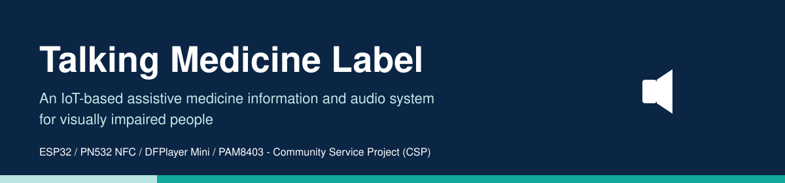
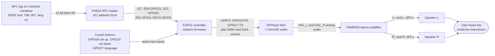
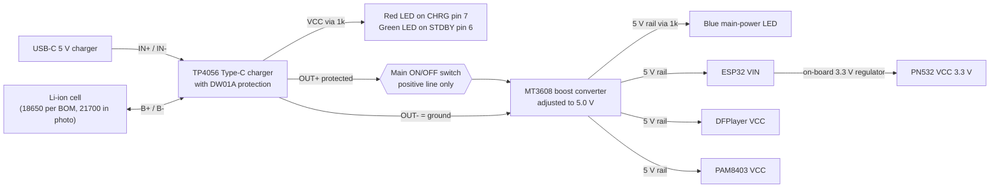
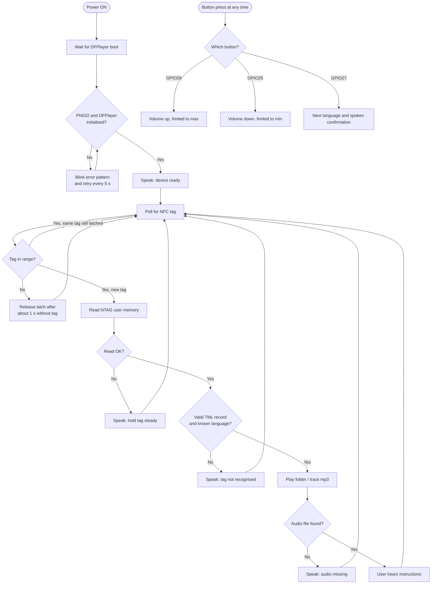

<p align="center"></p>

# Talking Medicine Label

**An IoT-Based Assistive Medicine Information and Audio System for Visually Impaired People**

Community Service Project (CSP) - IoT / assistive technology.

     

## Table of contents
[Project status](#project-status) - [What is this project](#what-is-this-project) - [Who benefits](#who-benefits) - [Key features](#key-features) - [System architecture](#system-architecture) - [Components](#components) - [Connections](#hardware-connection-table) - [Wiring diagram](#wiring-diagram) - [Source code](#source-code) - [NFC tag data format](#nfc-tag-data-format) - [Power and charging](#power-management-and-charging) - [Assembly](#assembly) - [Testing and troubleshooting](#testing-and-troubleshooting) - [Limitations](#limitations-and-future-work) - [Academic documentation](#academic-project-documentation) - [Quick start](#installation-and-quick-start) - [Credits and licence](#credits-license-and-contributions)

## Project status

| Item | Status |
|---|---|
| Hardware design and connection table | Complete on paper, checked against supplier documentation |
| Firmware (`firmware/talking-medicine-label`) | Written. **Not compiled in Arduino IDE, not run on hardware** |
| NDEF tag parser | Unit-tested on a PC (11 cases pass) |
| Wiring diagram | Schematic-style SVG (generated, pin-matched) updated from the author's reference diagram |
| Author reference diagram | Analysed and merged; included in `images/circuit` (contains third-party photographs, licence unchecked) |
| Animations | Animated SVGs in every Markdown file (see note under Credits) |
| Component photographs | 15 images supplied by the author are included in `images/components` (DFPlayer and PAM8403 shown as two-view images). NFC tag, microSD and passives are still pending. **Original sources and licences are not recorded**: confirm before publishing; see [`docs/references.md`](docs/references.md) |
| Audio recordings | Not supplied: you must record and have them reviewed |
| Wi-Fi, cloud, translation, AI | **Not implemented and not planned in this version** |

## What is this project

Many medicine boxes use tiny print. A person who is blind, has low vision, or cannot read small text may not be able to tell which medicine is in their hand.

In this project a small **NFC tag** is stuck on the container. The tag stores a short code (for example `TML:007`) and a language (for example Telugu). When the container is held near the device, the **PN532 NFC reader** reads the tag and passes the data to the **ESP32**, the small computer that controls everything. The ESP32 works out which recording to play and tells the **DFPlayer Mini** to play that file from its **microSD card**. The sound goes through the **PAM8403 amplifier** to two mini **speakers** (left and right), so the user hears the instructions. Three push buttons let the user raise or lower the volume and change the language, and LEDs show charging, full-charge and power-on states. A rechargeable **18650 battery**, a **TP4056 charger board** and an **MT3608 boost converter** make the device portable: the booster turns the battery's 3-4.2 V into the 5 V the electronics need, and the TP4056 handles charging through a USB-C cable.

## Who benefits

- **People who are blind or have low vision:** hear which medicine they hold.
- **Older adults** who struggle with small print.
- **Anyone who finds printed labels hard to read.**
- **Caregivers and family:** can prepare tags and recordings once.
- **Community healthcare and accessibility initiatives:** a low-cost, offline, repeatable build.

The device is an aid only. It does **not** replace doctors, pharmacists or the prescribed instructions, and recordings must be checked by a qualified person.

## Key features

| Feature | Status |
|---|---|
| NFC-triggered audio playback | Implemented in code, not hardware-tested |
| Prerecorded instructions from microSD | Implemented in code (you supply audio) |
| Multiple languages (English, Telugu; Hindi folder reserved), chosen with the language button | Implemented as folder mapping; only recordings you add exist |
| Same-tag repeat prevention and re-detection | Implemented in code |
| Spoken error prompts (bad tag, missing audio, read error) | Implemented in code; needs `/99` files |
| Portable, rechargeable operation | Hardware design; capacity and runtime unverified |
| Volume up/down and language buttons (GPIO26, GPIO25, GPIO27) | Implemented in code, not hardware-tested |
| LED indicators (charging, full, power ON) | Hardware only (no firmware needed) |
| Stereo output with two speakers | Hardware design; current budget needs checking |
| Automatic translation, text-to-speech, internet, cloud, AI | **Not provided** |

## System architecture



Signal flow (animated):

<p align="center"></p>

Power flow:



Operating workflow:



## Components

| Component | Photo | Purpose | Key specifications | Relevant pins | Source |
|---|---|---|---|---|---|
| MT3608 boost converter (Micro-USB) |  | 3-4.2 V to 5 V | In 2-24 V, out 5-28 V, 2 A max | VIN+, VIN-, OUT+, OUT- | [Robu](https://robu.in/?p=29763) |
| TP4056 Type-C charger with protection |  | Charge and protect the cell | 1 A, 4.2 V, DW01A + 8205A | OUT-, B-, B+, OUT+, LED1/LED2 pads | [ShillehTek manual](https://shillehtek.com/blogs/shillehtek-product-manuals/tp4056-1a-lipo-battery-charging-board-type-c-with-current-protection-manual) |
| PAM8403 amplifier (two views, HW-104 on the right) |  | Drive two speakers | 2.5-5.5 V, 3 W/ch at 4 ohm, BTL, no volume pot | Inputs L, GND, R; power +5V, GND; outputs L-, L+, R+, R- | [Envistia guide](https://envistiamall.com/blogs/learn/pam8403-stereo-audio-amplifier-with-volume-control-switch-user-guide) |
| DFPlayer Mini MP3-TF-16P V3.0 (two views) |  | Play mp3 files from microSD | 3.2-5 V, 3.3 V UART | VCC, RX, TX, DAC_R, DAC_L, GND (pins 1-8); GND (pin 10) | [Manual](https://robu.in/wp-content/uploads/2017/06/DFR0299-DFPlayer-Mini-Manual.pdf) |
| ESP32 NodeMCU 30-pin (CP2102) |  | Controller | 3.3 V logic, 5 V on VIN | VIN, 3V3, GND x2, D21, D22, TX2, RX2, D25, D26, D27 | [Pinout guide](https://esp32.co.uk/esp32-nodemcu-30-pin-pinout-safe-gpios/) |
| PN532 NFC/RFID V3 |  | Read NFC tags | 13.56 MHz, I2C address 0x24 | I2C header SCL, SDA, VCC, GND; IRQ and RSTO on the bottom header; mode DIP switch | [ShillehTek manual](https://shillehtek.com/blogs/shillehtek-product-manuals/pn532-nfc-rfid-reader-writer-module-v3-manual) |
| Li-ion cell (BOM says 18650; photo is marked INR21700-45E) |  | Power source | 3.7 V nominal; 4500 mAh class if it is a genuine 21700 cell | +, - | see [power doc](docs/power-management.md) |
| Main ON/OFF slide switch (SPDT) |  | Interrupt the positive line | Rated above 2 A | COM, OUT, NC | none verified |
| 3 push buttons (6 mm tactile) |  | Volume down (D25), volume up (D26), language (D27) | Momentary, normally open | One side to GPIO, other to GND* | none verified |
| Red LED (charging) |  | Charging indicator | About 3 mA with 1 kOhm | Anode (longer leg) toward the resistor | none verified |
| Green LED (fully charged) |  | Fully-charged indicator | About 3 mA with 1 kOhm | Anode (longer leg) toward the resistor | none verified |
| Blue LED (power ON) |  | Main-power indicator | About 3 mA with 1 kOhm | Anode (longer leg) toward the resistor | none verified |
| Resistors (1 kOhm x3 and 1 kOhm UART resistor) |  | LED current limit; UART series resistor | 1 kOhm = brown, black, red, gold | - | **Photo caution:** this picture's bands read brown-black-gold-gold (1 ohm), not 1 kOhm; use as a generic illustration only |
| 2 mini speakers (L and R) |  | Sound | **8 ohm, 0.5 W each**: cap the volume | + / - | none verified |
| Prototype PCB (perfboard) |  | Mounting and wiring the modules | Single-sided, 2.54 mm pitch | - | none verified |
| NFC tag (NTAG213 or larger) | photo pending | Stores medicine ID | 144 bytes user memory | - | [NXP datasheet](https://nxp.com/docs/en/data-sheet/NTAG213_215_216.pdf) |
| microSD card | photo pending | Stores audio | FAT32, 32 GB or less | - | DFPlayer manual |
| Passives (470 uF, 100 nF), wires, enclosure | photo pending | Reliability | see hardware doc | - | - |

**About these photographs:** they were supplied by the project author. Their original sources and licences were **not recorded**, so they are listed as "unverified" in [`docs/references.md`](docs/references.md); confirm the rights (or replace them with your own photos) before publishing the repository publicly. Observations taken from the photos: the ESP32 board is labelled D21, D22, TX2, RX2, D25, D26, D27, VIN, 3V3 and two GND pins; the PAM8403 is the HW-104 variant (no volume pot); the PN532 offers a four-pin I2C header (SCL, SDA, VCC, GND) and a mode DIP switch; the TP4056 board shows LED1/LED2 footprints on its right edge; the cell is marked INR21700-45E; the speakers are marked 8 ohm 0.5 W; the resistor photo's colour bands do not match 1 kOhm.

### Component gallery

Each photo carries its component name along the top.

<table>
<tr><td align="center" width="33%"></td><td align="center" width="33%"></td><td align="center" width="33%"></td></tr>
<tr><td align="center" width="33%"></td><td align="center" width="33%"></td><td align="center" width="33%"></td></tr>
<tr><td align="center" width="33%"></td><td align="center" width="33%"></td><td align="center" width="33%"></td></tr>
<tr><td align="center" width="33%"></td><td align="center" width="33%"></td><td align="center" width="33%"></td></tr>
<tr><td align="center" width="33%"></td><td align="center" width="33%"></td><td align="center" width="33%"></td></tr>
</table>

Accessories (tag, microSD, passives, enclosure) are **not assumed to be available**.

## Hardware connection table

| No. | From Component | From Pin | To Component | To Pin | Purpose | Voltage / Notes |
|---|---|---|---|---|---|---|
| 1 | Li-ion cell (18650 per BOM; photo shows 21700) | + | TP4056 | B+ | Battery to charger/protection | 3.0-4.2 V. Verify polarity before connecting |
| 2 | Li-ion cell (18650 per BOM; photo shows 21700) | - | TP4056 | B- | Battery return | 0 V reference of the cell |
| 3 | TP4056 | OUT+ | Main switch (SPDT slide) | COM | Protected supply into the switch | 2.5-4.2 V (DW01A-protected). **From the reference diagram** |
| 4 | Main switch | OUT terminal | MT3608 | VIN+ | Switched positive supply | NC terminal left unconnected. Confirm with a meter that OUT closes to COM in the ON position |
| 5 | TP4056 | OUT- | MT3608 | VIN- | Common return | Never switched |
| 6 | MT3608 | OUT+ | ESP32 | VIN | 5 V supply for the ESP32 board | Set and measure 5.0 V first. Board regulator makes 3.3 V. The MT3608 silkscreen reads OUT+ / OUT- |
| 7 | MT3608 | OUT+ | DFPlayer Mini | VCC | Supply | Module accepts 3.2-5.0 V; 5.0 V used |
| 8 | MT3608 | OUT+ | PAM8403 (HW-104) | 5V | Supply | Module accepts 2.5-5.5 V |
| 9 | MT3608 | OUT- | ESP32 GND (left pin, beside VIN), PAM8403 GND (power), blue LED cathode | GND | Main ground rail | Short, thick leads |
| 10 | ESP32 | 3V3 | PN532 | VCC | PN532 supply | 3.3 V; about 50 mA active. Header order on the PN532: GND, VCC, SDA, SCL |
| 11 | ESP32 | GND (right side, beside 3V3) | PN532 | GND | Ground | **Updated from the reference diagram** (not the main rail) |
| 12 | ESP32 | GPIO21 | PN532 | SDA/TXD | I2C data | 3.3 V logic. PN532 DIP: S1 ON, S2 OFF |
| 13 | ESP32 | GPIO22 | PN532 | SCL/RXD | I2C clock | 3.3 V logic. Address 0x24 |
| 14 | ESP32 | GPIO17 (TX2) | 1 kOhm resistor then DFPlayer | RX | Commands to DFPlayer | 3.3 V UART, 9600 baud |
| 15 | DFPlayer Mini | TX | ESP32 | GPIO16 (RX2) | Status from DFPlayer | 3.3 V logic level |
| 16 | DFPlayer Mini | GND (pin 7, same header as VCC/RX/TX) | ESP32 | GND (right side, beside 3V3) | DFPlayer ground reference | Same ESP32 GND pin as Nos. 11 and 34 |
| 17 | DFPlayer Mini | DAC_L (pin 5) | PAM8403 | L (audio in) | Left line-level audio | Not SPK1/SPK2 |
| 18 | DFPlayer Mini | DAC_R (pin 4) | PAM8403 | R (audio in) | Right line-level audio | Not SPK1/SPK2 |
| 19 | DFPlayer Mini | GND (pin 10, opposite header) | PAM8403 | GND (between L and R inputs) | Audio signal ground | Keep short, run next to the DAC wires |
| 20 | PAM8403 | L+ | Speaker L | + terminal | Left channel | BTL output |
| 21 | PAM8403 | L- | Speaker L | - terminal | Left channel | NEVER to ground or to R- |
| 22 | PAM8403 | R+ | Speaker R | + terminal | Right channel | BTL output |
| 23 | PAM8403 | R- | Speaker R | - terminal | Right channel | NEVER to ground or to L- |
| 24 | 5 V rail | + | C1 470 uF / C2 100 nF | + | Decoupling at DFPlayer/PAM8403 | Recommended; C1 rated 10 V or higher |
| 25 | TP4056 | VCC (USB 5V pad) | 1 kOhm resistor, then red LED anode (+) | - | Charging indicator, red | Lights only while USB power is present |
| 26 | Red LED | cathode (-) | TP4056 | CHRG, IC pin 7 | Charging indicator, red | Reference diagram solders to the chip pin; open-drain output pulled low while charging |
| 27 | TP4056 | VCC (USB 5V) | 1 kOhm resistor, then green LED anode (+) | - | Fully-charged indicator, green | **New** |
| 28 | Green LED | cathode (-) | TP4056 | STDBY, IC pin 6 | Fully-charged indicator, green | Pulled low when charge is complete |
| 29 | MT3608 | OUT+ (switched regulated +5 V) | 1 kOhm resistor, then blue LED anode (+) | - | Main-power indicator | **New.** About 3 mA |
| 30 | Blue LED | cathode (-) | GND rail | - | Main-power indicator | |
| 31 | ESP32 | GPIO26 (D26) | Push button, middle (Volume Up) | one side | Each press raises the volume | Other side to GND*. Internal pull-up |
| 32 | ESP32 | GPIO25 (D25) | Push button, top (Volume Down) | one side | Each press lowers the volume | Other side to GND*. Internal pull-up |
| 33 | ESP32 | GPIO27 (D27) | Push button, bottom (Language) | one side | Each press selects the next language | Other side to GND*. Internal pull-up |
| 34 | Push buttons (x3) | common other side | ESP32 | GND (right side, beside 3V3) = GND* | Button return | **Updated from the reference diagram**: joins the same pin as Nos. 11 and 16 |
| 35 | ESP32 | GPIO2 | on-board LED | - | Status indication | No external wiring (verify on your board) |
| 36 | PN532 | RSTO | ESP32 | GPIO5 (D5) | PN532 reset-output line, monitored by the firmware | **New.** 3.3 V logic. Read as an input only. GPIO5 is a strapping pin (must be high at boot) |
| 37 | PN532 | IRQ | ESP32 | GPIO4 (D4) | PN532 data-ready interrupt (active low) used by the Adafruit library in I2C mode | **New.** 3.3 V logic |

Electrical rules, unresolved items and the verification status are in [`docs/circuit-connections.md`](docs/circuit-connections.md). Key rules: switch in the positive line only; set the MT3608 to 5.0 V before connecting anything; DFPlayer **DAC_L/DAC_R** (not SPK1/SPK2) to the PAM8403; DFPlayer ground from the ESP32 GND beside 3V3 and PAM8403 GND_in from DFPlayer pin 10 (watch for hum); PAM8403 speaker terminals never to ground; confirm the GPIOs and protection chips on **your** board versions.

## Reference wiring diagram (author-supplied)


The author supplied this annotated diagram of the intended build. Its details have been merged into the connection table and the schematic below.

| Item | What the reference diagram shows | Repository status |
|---|---|---|
| Switch | SPDT slide switch with terminals NC, COM, OUT. TP4056 OUT+ goes to **COM**; the **OUT** terminal goes to MT3608 VIN+; NC is unused | Applied (rows 3 and 4) |
| MT3608 | Silkscreen VIN+, VIN-, OUT+, OUT-. OUT+ feeds the 5 V rail and the blue LED resistor; OUT- feeds the ground rail | Applied; names changed from VOUT to OUT |
| 5 V rail taps | MT3608 OUT+, ESP32 VIN, DFPlayer VCC, PAM8403 5V, blue LED resistor | Applied |
| Ground rail taps | MT3608 OUT-, ESP32 left GND pin, PAM8403 power GND, blue LED cathode | Applied |
| GND* (ESP32 GND beside 3V3) | Joins PN532 GND, DFPlayer GND (left header, pin 7) and the common return of the three buttons | Applied (rows 11, 16, 34) |
| PN532 header | Pins in order GND, VCC (to 3V3), SDA (to D21), SCL (to D22) | Applied |
| UART | ESP32 TX2 through a resistor to DFPlayer RX; DFPlayer TX to ESP32 RX2 | Applied |
| Buttons | Top = D25, middle = D26, bottom = D27 | Applied: D25 volume down, D26 volume up, D27 language |
| Audio | DAC_L to PAM8403 L, DAC_R to PAM8403 R; DFPlayer GND on the opposite header (pin 10) to the PAM8403 GND between L and R | Applied (rows 17-19) |
| PAM8403 module | HW-104 variant: inputs L, GND, R; power 5V, GND; outputs L-, L+, R+, R-; no volume pot visible | Documented |
| Speakers | Top speaker on L-/L+, bottom speaker on R+/R- | Applied |
| TP4056 LEDs | Red and green LED chains from the VCC pad through resistors; cathodes go to the chip pins marked 7 (CHRG) and 6 (STDBY) | Applied (rows 25-28) |
| Charger/battery | B- and B+ to the cell; OUT- straight to MT3608 VIN- | Applied |

**Caveats:** the reference diagram is an illustration, not a measured build. The red and green LED wires land on the TP4056 *chip pins* 7 and 6, which is fragile to solder (check whether your module offers LED pads instead). It does not show the decoupling capacitors (C1/C2), which remain recommended, or the PN532 DIP switch positions (set S1 ON, S2 OFF for I2C and confirm with an I2C scan). The component pictures inside it are third-party photographs of unknown licence, so see `docs/references.md` before publishing the repository.

## Wiring diagram


This is a pin-accurate **schematic-style** diagram generated from the same data as the table and firmware. It does not use component photographs and shows logical, not physical, pin positions; a photo-based diagram is future work.

## Source code

Folder: [`firmware/talking-medicine-label`](firmware/talking-medicine-label/README.md). Files: `talking-medicine-label.ino`, `ndef_parser.h`, `config.example.h`. Libraries: Adafruit PN532 (with Adafruit BusIO) and DFRobotDFPlayerMini, installed through Arduino Library Manager; board package *esp32 by Espressif*, board *ESP32 Dev Module*. **Exact tested library versions: none yet** (not compiled). Buttons: GPIO26 volume up, GPIO25 volume down, GPIO27 language. Core of the loop:

```cpp
bool found = nfc.readPassiveTargetID(PN532_MIFARE_ISO14443A, uid, &uidLen, TAG_POLL_TIMEOUT_MS);
// new tag -> read NTAG pages 4..19 -> parseTmlNdef() -> folderForLang() -> dfp.playFolder(folder, id)
```

## NFC tag data format

<p align="center"></p>

| Where | What |
|---|---|
| NFC tag | One NDEF Text record: language (`en`, `te`, `hi`) + text `TML:<1-255>` (about 16 bytes). NTAG213 offers 144 bytes |
| microSD | `/01/007.mp3` (English), `/02/007.mp3` (Telugu), `/99/00x.mp3` system prompts |

The playback language is chosen with the language button (the tag's language code must be valid but is not used unless `LANGUAGE_FROM_TAG` is 1). The tag does not hold audio or long text, and nothing is translated automatically. Examples: [`nfc-data/examples`](nfc-data/examples/medicine-example-te.txt). Details: [`nfc-data/README.md`](nfc-data/README.md), [`audio/README.md`](audio/README.md).

## Power management and charging

<p align="center"></p>

Battery to TP4056 B+/B-; OUT+ through the switch to MT3608 VIN+; OUT- to VIN-. The MT3608 only boosts voltage and **cannot charge the battery**; the TP4056 does that from USB-C. Charge with the switch OFF. Before first power-up, measure and set the MT3608 to 5.0 V. The supplied speakers are only **8 ohm, 0.5 W**, so the volume must be capped (firmware range 3-15, to be calibrated to about 2 V RMS across a speaker). At that level the 5 V rail needs about 0.2-0.5 A; an overdriven amplifier could pull far more and would damage the speakers. The cell in the supplied photo is marked **INR21700-45E**, i.e. a **21700** cell rather than the 18650 in the bill of materials; confirm which you have, and measure the real capacity. Full procedure, tables and battery safety: [`docs/power-management.md`](docs/power-management.md).

## Assembly

1 inspect, 2 confirm pinouts, 3 power section, 4 tune the MT3608, 5 ESP32 + PN532, 6 DFPlayer, 7 amplifier + speaker, 8 microSD, 9 program, 10 test tag and audio, 11 verify switch and charging, 12 enclose. Each step has a checkpoint in [`docs/assembly-guide.md`](docs/assembly-guide.md).

## Testing and troubleshooting

<details><summary>Troubleshooting summary (full table with multimeter checks in docs)</summary>

| Symptom | First checks |
|---|---|
| PN532 not detected | DIP switches I2C (S1 ON, S2 OFF), SDA/SCL, 3.3 V, scan for 0x24 |
| Tag not recognised | Tag type NTAG (7-byte UID), distance, metal, NDEF format |
| DFPlayer not initialised | TX/RX crossed, FAT32 SD, 5 V supply, 2 s boot delay |
| File not found | `/NN/NNN.mp3` naming, remove `._` files |
| No sound | PAM8403 knob/power, speaker on L+/L- only, DAC_L wiring |
| Noise / hum | C1/C2 decoupling, short twisted audio wires, lower volume, check the GND_in / pin 10 arrangement |
| ESP32 resets | 5 V sag: lower the volume cap, bigger capacitor, test with a bench supply |
| Buzzing or distorted speaker | Speaker (0.5 W) overdriven: lower `VOLUME_MAX`, check about 2 V RMS across the speaker |
| Buttons / LEDs | Buttons to GND, LED polarity, red/green need USB power |
| Converter wrong | Remove load, re-adjust to 5.0 V |
| Charging problems | Switch OFF, check IN voltage and LEDs, suspect cell |

</details>

Tests actually performed: PC unit test of the tag parser (11/11 pass); relative-link check; wiring SVG rendered and visually inspected; firmware syntax-checked only against my own stub headers (not the real libraries). **Not performed:** compilation in Arduino IDE, any hardware test. Checklist: [`tests/hardware-validation-checklist.md`](tests/hardware-validation-checklist.md). More: [`docs/testing-and-troubleshooting.md`](docs/testing-and-troubleshooting.md).

## Limitations and future work

**Current limitations:** untested on hardware; prerecorded audio only; NTAG tags in the TML format only; 3-7 cm read range; capacity and converter headroom unverified; no battery indicator. **Proposed, not implemented:** more Indian languages, tactile buttons, battery-level announcements, sleep mode, better enclosure, tag authentication, optional offline TTS. See [`docs/limitations.md`](docs/limitations.md).

## Academic project documentation

**Abstract.** This project presents a low-cost, battery-powered NFC device that speaks prerecorded medicine information to help visually impaired and elderly users identify medicines. An ESP32 reads an NTAG tag through a PN532 and plays a language-specific recording from a microSD card through a DFPlayer Mini, PAM8403 amplifier and speaker.

**Problem statement.** Printed medicine labels are hard or impossible to read for people with visual impairment or limited literacy, raising the risk of mistakes.

**Objectives.** (1) Identify a medicine from an NFC tag. (2) Play instructions in the user's language offline. (3) Operate from a rechargeable battery. (4) Document a safe, reproducible build.

**Proposed solution.** Tag stores a medicine ID and language; recordings stored on microSD; firmware maps tag to file.

**Hardware requirements.** See [Components](#components) (including two speakers, three buttons and three LEDs). **Software requirements.** Arduino IDE 2.x, esp32 board package, Adafruit PN532, Adafruit BusIO, DFRobotDFPlayerMini, an NFC-writer phone app, an audio recorder.

**Methodology.** Component research and datasheet verification; circuit design with rules for power, audio and logic levels; modular firmware with a hardware-independent parser; unit testing of the parser; planned hardware validation using the checklist.

**Results and testing status.** Parser tests pass (11/11). Firmware compilation and hardware tests are pending; no performance claims are made.

**Social impact.** Greater independence and safety for people who cannot read labels; low cost; offline; local-language support.

**Limitations and future scope.** As above. **Conclusion.** The design shows a feasible assistive solution; hardware validation and professionally reviewed audio are the next steps.

**References.** [`docs/references.md`](docs/references.md).

## Installation and quick start

1. Install Arduino IDE 2.x and the *esp32 by Espressif Systems* board package; select *ESP32 Dev Module*.
2. Install libraries: Adafruit PN532 (and Adafruit BusIO), DFRobotDFPlayerMini.
3. Review `firmware/talking-medicine-label/config.example.h` (optional copy to `config.h`).
4. Prepare the microSD (FAT32) per [`audio/README.md`](audio/README.md), including `/99` prompts.
5. Write NFC tags per [`nfc-data/README.md`](nfc-data/README.md).
6. Build the circuit following the assembly guide; tune the MT3608 to 5.0 V first.
7. Upload with the main switch OFF (USB powered), then run from battery and watch the Serial Monitor at 115200 baud.

## Credits, license and contributions

Code and original documentation: MIT licence ([`LICENSE`](LICENSE)); replace the placeholder copyright holder. Technical information comes from the sources in [`docs/references.md`](docs/references.md); the DFPlayer library is by DFRobot and the PN532 library by Adafruit (their own licences). Third-party photographs, if added, keep their own licences. Animations are SVG (SMIL) files generated by `diagrams/generate_animated_svgs.py`; GitHub plays them when embedded as images, other Markdown viewers may show a still frame. Contributions: [`CONTRIBUTING.md`](CONTRIBUTING.md). Safety: [`SECURITY.md`](SECURITY.md), [`docs/safety-guidelines.md`](docs/safety-guidelines.md).
