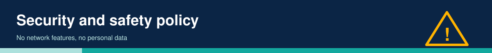

# Security and Safety Policy

This project has no network features (Wi-Fi is never started) and stores no personal data. Tags carry only a medicine ID and language code.

Report safety or security concerns (e.g. wiring that could overheat a battery, tag-spoofing risks) by opening a private security advisory on GitHub, or contact the maintainer listed in the repository profile. Note: tag IDs are not authenticated, so anyone can write a tag that plays a different recording; use NTAG password protection or tamper-evident tags if that matters.
