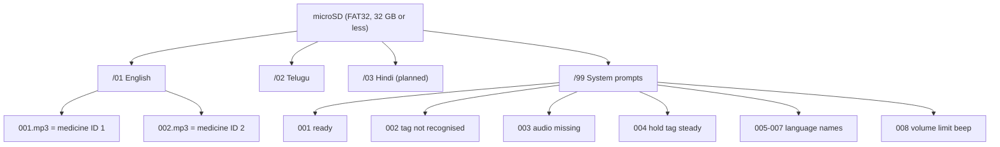

# Audio (microSD card)

*DFPlayer Mini photographs supplied by the project author (licence unverified; see `docs/references.md`).*

Folders are two digits (01-99) and files three digits (001-255), matching the DFPlayer `playFolder(folder, file)` command (manual section 3.4.4). The firmware plays `/<folder>/<id>.mp3`.

`/99/005.mp3` = "English", `006` = "Telugu" (spoken in Telugu), `007` = "Hindi" (only if enabled), `008` = short beep at the volume limits. The language button speaks 005/006 so the user knows which language is active.

**Recording guidelines:** mono mp3 (the same signal plays on both speakers), 44.1 kHz, 128 kbps; speak medicine name, strength, when/how to take, key warning, and "follow your doctor's advice"; have a pharmacist review. Telugu recordings should be by a native speaker. The `/99` prompts are required when `ENABLE_SYSTEM_PROMPTS` is 1. This repository ships **no audio files**.

**SD tips:** copy files into the folders in numeric order; on macOS run `dot_clean /Volumes/<card>` to delete `._` files; no sub-folders inside language folders.
