# Accessibility and Usability

This is a design guide, not a record of user testing: **no user testing has been done yet**.

## Principles

1. **Everything important is spoken.** Power-on, errors, language changes and missing audio all have recordings in `/99`.
2. **Everything important is touchable.** Buttons differ in shape, the tap zone has a raised dot, and the switch is a physical slider (see [enclosure-and-layout.md](enclosure-and-layout.md)).
3. **One action, one result.** Tap a tag to hear; press a button to change volume or language. No menus.
4. **Fail audibly.** An unreadable or unknown tag is announced, not silent.
5. **Never replace professional advice.** Every recording ends by telling the user to ask the pharmacist or doctor if unsure.

## Recording structure

Keep each recording short (aim for under 30 seconds) in this order: medicine name, strength, how and when to take it, one key warning, the reminder to ask the pharmacist or doctor. Use a clear, unhurried voice, the same speaker per language, and the same order every time so users learn what to expect.

## Prompts to record in `/99`

| File | Text |
|---|---|
| 001 | Device ready |
| 002 | This tag is not recognised |
| 003 | Audio for this medicine is missing |
| 004 | The tag could not be read. Hold it steady and try again |
| 005 | English |
| 006 | Telugu (spoken in Telugu) |
| 007 | Hindi (only if enabled) |
| 008 | short beep at the volume limit |

## Setting up tags with a caregiver

Place each tag in the same spot on every container (for example the lid centre) with a small raised mark beside it so the user can find it. Write the medicine ID, medicine name and language in a register (`nfc-data/medicine-register-template.csv`). Re-check the register whenever a prescription changes.

## Trial plan (to be carried out)

Invite a small number of volunteers, with informed consent and supervision by a pharmacist or teacher. Measure: whether they find the tap zone unaided, whether they understand each prompt, whether the volume is comfortable, and which errors they trigger. Record findings in the repository before claiming any benefit.

## Open questions

Is the 0.5 W speaker loud enough for older users with hearing loss? Do users prefer one fixed language? Is a larger tactile cue needed on the buttons? These are unanswered until testing.
