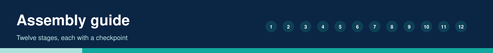

# Assembly Guide

```mermaid
flowchart LR
  S1["1 Inspect"] --> S2["2 Pinouts"] --> S3["3 Power section"] --> S4["4 Tune MT3608"] --> S5["5 ESP32 + PN532"] --> S6["6 DFPlayer"] --> S7["7 Amp + speaker"] --> S8["8 microSD"] --> S9["9 Program"] --> S10["10 Test tag"] --> S11["11 Switch + charge"] --> S12["12 Enclose"]
```

Use `tests/hardware-validation-checklist.md` to record each result. Do not advance until the checkpoint passes.

1. **Identify and inspect.** Check solder joints, chip markings (TP4056 + DW01A + 8205A; MT3608; PAM8403; PN532). *Checkpoint:* no bridges, no damaged parts.
2. **Confirm pinouts** against the silkscreen of your boards and `circuit-connections.md`. *Checkpoint:* every label found. Note PN532 and ESP32 revisions.
3. **Power section.** Cell -> TP4056 B+/B-; OUT+ -> switch COM; switch OUT terminal -> MT3608 VIN+ (NC unused); OUT- -> VIN-. Nothing else connected. *Checkpoint:* cell voltage 3.0-4.2 V; USB-C charge LED lights.
4. **Tune the converter** (see `power-management.md`). *Checkpoint:* 5.0 V measured.
5. **ESP32 + PN532.** PN532 DIP to I2C (S1 ON, S2 OFF) with power off. 3V3, GND (the ESP32 GND beside 3V3), GPIO21 (SDA), GPIO22 (SCL), plus IRQ to GPIO4 and RSTO to GPIO5. Feed ESP32 VIN from the 5 V rail. *Checkpoint:* serial monitor shows "PN532 online"; 3V3 pin 3.3 V.
6. **DFPlayer.** VCC 5 V, GND, TX -> GPIO16, RX <- 1 kOhm <- GPIO17. No SD yet or with SD inserted. *Checkpoint:* DFPlayer initialises (needs SD).
7. **Amplifier and speakers.** DFPlayer DAC_L -> PAM8403 L, DAC_R -> R, DFPlayer pin 10 (GND) -> PAM8403 GND_in; DFPlayer GND -> ESP32 GND pin beside 3V3; PAM8403 VCC/GND to the rails. Speaker L across L+/L-, Speaker R across R+/R-. Fit C1/C2. *Checkpoint:* L- and R- read open to ground and to each other.
7b. **Buttons and LEDs.** Buttons GPIO26 (vol +), GPIO25 (vol -), GPIO27 (language) each to GND. Red LED (1 kOhm from TP4056 VCC) to CHRG pin 7, green LED to STDBY pin 6, blue LED from the switched 5 V rail via 1 kOhm to GND. *Checkpoint:* blue LED lights with the switch ON; buttons print messages in the Serial Monitor.
8. **microSD.** FAT32, files per `audio/README.md`, including `/99` prompts.
9. **Program.** Install libraries per the firmware README; upload with the switch OFF and USB connected (the board runs from USB for flashing). Disconnect USB, then use battery.
10. **Test tag and audio.** Tap a programmed NTAG; try the volume and language buttons. *Checkpoint:* correct recording, no repeat while held, replays after removal.
11. **Switch and charging.** Switch OFF: no current. Switch ON: starts. Charge with switch OFF; red LED then green. *Checkpoint:* converter keeps 5.0 V during charging cycle and playback.
12. **Enclose.** Keep PN532 antenna facing the tag area, away from metal; strain-relieve wires; mark the tag area with a raised dot for touch; keep the cell insulated and ventilated.
