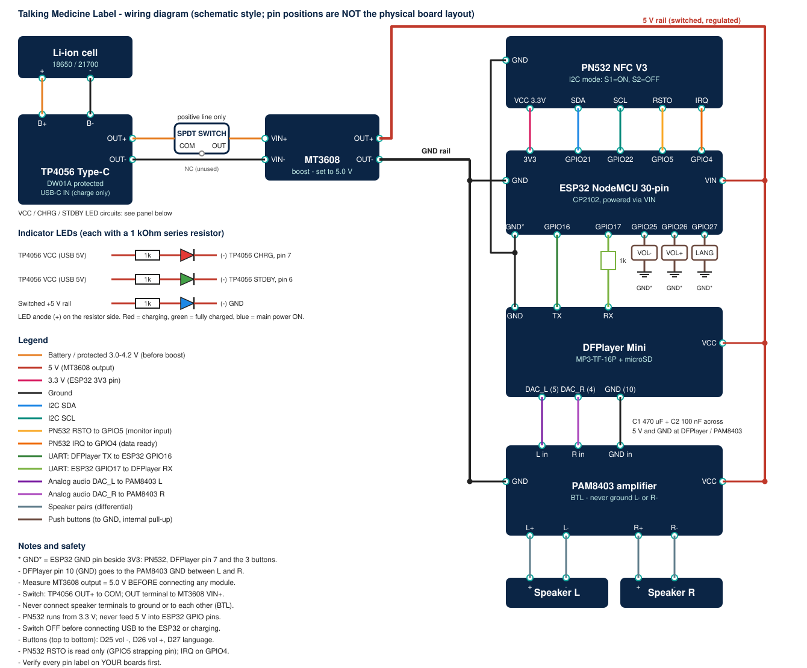
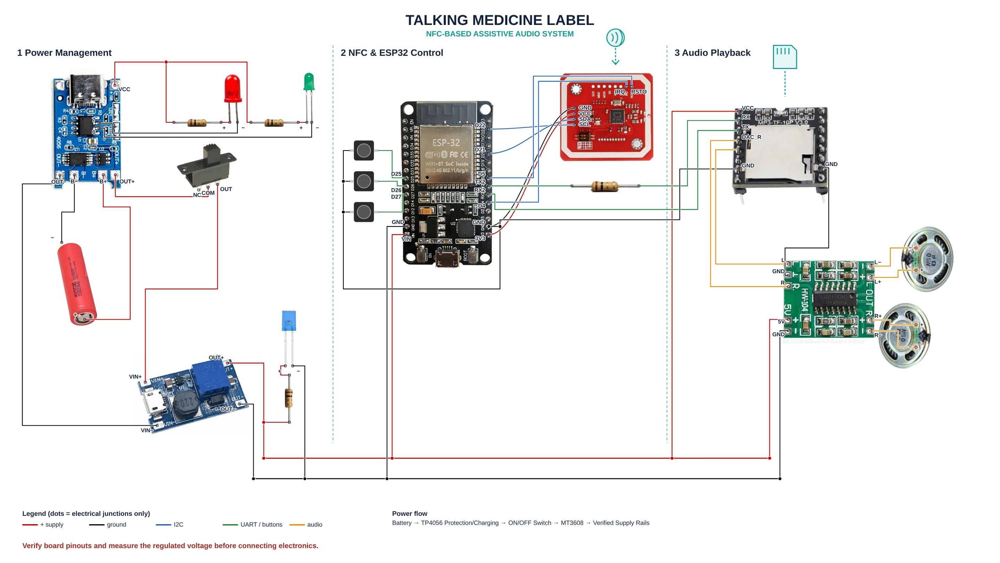

# Circuit Connections

*Schematic-style diagram generated by `diagrams/generate_wiring_diagram.py`. Pin positions are logical, not the physical layout of the boards. A photograph-based wiring diagram is listed as future work because verified component photographs are not yet committed (see `references.md`).*

## Reference diagram supplied by the author

| Item | What the reference diagram shows | Repository status |
|---|---|---|
| Switch | SPDT slide switch with terminals NC, COM, OUT. TP4056 OUT+ goes to **COM**; the **OUT** terminal goes to MT3608 VIN+; NC is unused | Applied (rows 3 and 4) |
| MT3608 | Silkscreen VIN+, VIN-, OUT+, OUT-. OUT+ feeds the 5 V rail and the blue LED resistor; OUT- feeds the ground rail | Applied; names changed from VOUT to OUT |
| 5 V rail taps | MT3608 OUT+, ESP32 VIN, DFPlayer VCC, PAM8403 5V, blue LED resistor | Applied |
| Ground rail taps | MT3608 OUT-, ESP32 left GND pin, PAM8403 power GND, blue LED cathode | Applied |
| GND* (ESP32 GND beside 3V3) | Joins PN532 GND, DFPlayer GND (left header, pin 7) and the common return of the three buttons | Applied (rows 11, 16, 34) |
| PN532 header | Pins in order GND, VCC (to 3V3), SDA (to D21), SCL (to D22) | Applied |
| UART | ESP32 TX2 through a resistor to DFPlayer RX; DFPlayer TX to ESP32 RX2 | Applied |
| Buttons | Top = D25, middle = D26, bottom = D27 | Applied: D25 volume down, D26 volume up, D27 language |
| Audio | DAC_L to PAM8403 L, DAC_R to PAM8403 R; DFPlayer GND on the opposite header (pin 10) to the PAM8403 GND between L and R | Applied (rows 17-19) |
| PAM8403 module | HW-104 variant: inputs L, GND, R; power 5V, GND; outputs L-, L+, R+, R-; no volume pot visible | Documented |
| Speakers | Top speaker on L-/L+, bottom speaker on R+/R- | Applied |
| TP4056 LEDs | Red and green LED chains from the VCC pad through resistors; cathodes go to the chip pins marked 7 (CHRG) and 6 (STDBY) | Applied (rows 25-28) |
| Charger/battery | B- and B+ to the cell; OUT- straight to MT3608 VIN- | Applied |

**Caveats:** the reference diagram is an illustration, not a measured build. The red and green LED wires land on the TP4056 *chip pins* 7 and 6, which is fragile to solder (check whether your module offers LED pads instead). It does not show the decoupling capacitors (C1/C2), which remain recommended, or the PN532 DIP switch positions (set S1 ON, S2 OFF for I2C and confirm with an I2C scan). The component pictures inside it are third-party photographs of unknown licence, so see `docs/references.md` before publishing the repository.

## Verification status

| Item | Status |
|---|---|
| Connections follow manufacturer/supplier documentation listed in `references.md` | Verified on paper |
| Wiring built and powered up on real hardware | **Not yet done** |
| Firmware pin numbers equal this table (GPIO21, 22, 16, 17, 25, 26, 27) | Cross-checked in `firmware/.../config.example.h` |
| GPIO16/17/21/22/25/26/27 physically exposed on **your** 30-pin board | The reference diagram's board picture is labelled D21, D22, TX2, RX2, D25, D26, D27 and shows two GND pins (one beside VIN, one beside 3V3). **Still confirm on your physical board** |

## Connection table

| No. | From Component | From Pin | To Component | To Pin | Purpose | Voltage / Notes |
|---|---|---|---|---|---|---|
| 1 | Li-ion cell (18650 per BOM; photo shows 21700) | + | TP4056 | B+ | Battery to charger/protection | 3.0-4.2 V. Verify polarity before connecting |
| 2 | Li-ion cell (18650 per BOM; photo shows 21700) | - | TP4056 | B- | Battery return | 0 V reference of the cell |
| 3 | TP4056 | OUT+ | Main switch (SPDT slide) | COM | Protected supply into the switch | 2.5-4.2 V (DW01A-protected). **From the reference diagram** |
| 4 | Main switch | OUT terminal | MT3608 | VIN+ | Switched positive supply | NC terminal left unconnected. Confirm with a meter that OUT closes to COM in the ON position |
| 5 | TP4056 | OUT- | MT3608 | VIN- | Common return | Never switched |
| 6 | MT3608 | OUT+ | ESP32 | VIN | 5 V supply for the ESP32 board | Set and measure 5.0 V first. Board regulator makes 3.3 V. The MT3608 silkscreen reads OUT+ / OUT- |
| 7 | MT3608 | OUT+ | DFPlayer Mini | VCC | Supply | Module accepts 3.2-5.0 V; 5.0 V used |
| 8 | MT3608 | OUT+ | PAM8403 (HW-104) | 5V | Supply | Module accepts 2.5-5.5 V |
| 9 | MT3608 | OUT- | ESP32 GND (left pin, beside VIN), PAM8403 GND (power), blue LED cathode | GND | Main ground rail | Short, thick leads |
| 10 | ESP32 | 3V3 | PN532 | VCC | PN532 supply | 3.3 V; about 50 mA active. Header order on the PN532: GND, VCC, SDA, SCL |
| 11 | ESP32 | GND (right side, beside 3V3) | PN532 | GND | Ground | **Updated from the reference diagram** (not the main rail) |
| 12 | ESP32 | GPIO21 | PN532 | SDA/TXD | I2C data | 3.3 V logic. PN532 DIP: S1 ON, S2 OFF |
| 13 | ESP32 | GPIO22 | PN532 | SCL/RXD | I2C clock | 3.3 V logic. Address 0x24 |
| 14 | ESP32 | GPIO17 (TX2) | 1 kOhm resistor then DFPlayer | RX | Commands to DFPlayer | 3.3 V UART, 9600 baud |
| 15 | DFPlayer Mini | TX | ESP32 | GPIO16 (RX2) | Status from DFPlayer | 3.3 V logic level |
| 16 | DFPlayer Mini | GND (pin 7, same header as VCC/RX/TX) | ESP32 | GND (right side, beside 3V3) | DFPlayer ground reference | Same ESP32 GND pin as Nos. 11 and 34 |
| 17 | DFPlayer Mini | DAC_L (pin 5) | PAM8403 | L (audio in) | Left line-level audio | Not SPK1/SPK2 |
| 18 | DFPlayer Mini | DAC_R (pin 4) | PAM8403 | R (audio in) | Right line-level audio | Not SPK1/SPK2 |
| 19 | DFPlayer Mini | GND (pin 10, opposite header) | PAM8403 | GND (between L and R inputs) | Audio signal ground | Keep short, run next to the DAC wires |
| 20 | PAM8403 | L+ | Speaker L | + terminal | Left channel | BTL output |
| 21 | PAM8403 | L- | Speaker L | - terminal | Left channel | NEVER to ground or to R- |
| 22 | PAM8403 | R+ | Speaker R | + terminal | Right channel | BTL output |
| 23 | PAM8403 | R- | Speaker R | - terminal | Right channel | NEVER to ground or to L- |
| 24 | 5 V rail | + | C1 470 uF / C2 100 nF | + | Decoupling at DFPlayer/PAM8403 | Recommended; C1 rated 10 V or higher |
| 25 | TP4056 | VCC (USB 5V pad) | 1 kOhm resistor, then red LED anode (+) | - | Charging indicator, red | Lights only while USB power is present |
| 26 | Red LED | cathode (-) | TP4056 | CHRG, IC pin 7 | Charging indicator, red | Reference diagram solders to the chip pin; open-drain output pulled low while charging |
| 27 | TP4056 | VCC (USB 5V) | 1 kOhm resistor, then green LED anode (+) | - | Fully-charged indicator, green | **New** |
| 28 | Green LED | cathode (-) | TP4056 | STDBY, IC pin 6 | Fully-charged indicator, green | Pulled low when charge is complete |
| 29 | MT3608 | OUT+ (switched regulated +5 V) | 1 kOhm resistor, then blue LED anode (+) | - | Main-power indicator | **New.** About 3 mA |
| 30 | Blue LED | cathode (-) | GND rail | - | Main-power indicator | |
| 31 | ESP32 | GPIO26 (D26) | Push button, middle (Volume Up) | one side | Each press raises the volume | Other side to GND*. Internal pull-up |
| 32 | ESP32 | GPIO25 (D25) | Push button, top (Volume Down) | one side | Each press lowers the volume | Other side to GND*. Internal pull-up |
| 33 | ESP32 | GPIO27 (D27) | Push button, bottom (Language) | one side | Each press selects the next language | Other side to GND*. Internal pull-up |
| 34 | Push buttons (x3) | common other side | ESP32 | GND (right side, beside 3V3) = GND* | Button return | **Updated from the reference diagram**: joins the same pin as Nos. 11 and 16 |
| 35 | ESP32 | GPIO2 | on-board LED | - | Status indication | No external wiring (verify on your board) |
| 36 | PN532 | RSTO | ESP32 | GPIO5 (D5) | PN532 reset-output line, monitored by the firmware | **New.** 3.3 V logic. Read as an input only. GPIO5 is a strapping pin (must be high at boot) |
| 37 | PN532 | IRQ | ESP32 | GPIO4 (D4) | PN532 data-ready interrupt (active low) used by the Adafruit library in I2C mode | **New.** 3.3 V logic |

> **Update after the reference photo-diagram:** the PN532 **RSTO to D5 (GPIO5)** and **IRQ to D4 (GPIO4)** wires (rows 36 and 37) were added by the author later. `images/circuit/reference-wiring-diagram.jpg` does **not** show them; the schematic SVG and the tables do.

## Electrical rules applied

1. The SPDT switch is in the positive line only: TP4056 OUT+ to COM, the OUT terminal to MT3608 VIN+, NC unused. OUT- goes straight to VIN-. Confirm with a meter which terminal connects to COM in the ON position, and check the labels on your boards.
2. Adjust the MT3608 to 5.0 V with a multimeter **before** connecting any module (`power-management.md`).
3. The ESP32 board is fed 5 V at VIN; its regulator makes 3.3 V. No 5 V is applied to any GPIO or to the 3V3 pin.
4. The PN532 is powered from 3.3 V. Its I2C pull-ups are on the module, so powering it from 5 V could put 5 V on SDA/SCL (not verified for every revision; avoid).
5. DFPlayer DAC_L and DAC_R (line level) feed the PAM8403 L and R inputs. SPK1/SPK2 of the DFPlayer are **not** used.
6. PAM8403 outputs are bridge-tied: Speaker L across L+/L-, Speaker R across R+/R-. No output terminal goes to ground or to another output.
7. Grounding as built (from the reference diagram): the PN532 GND, the DFPlayer GND (pin 7) and the buttons' common return all go to the ESP32 GND pin beside 3V3 (GND*), and the PAM8403 GND between L and R comes from DFPlayer pin 10. The ESP32 left GND pin, the PAM8403 power GND and the blue LED go to the MT3608 OUT- rail. **Caution:** most PAM8403 modules join GND and GND_in on the board, so this creates a second ground path (rail -> PAM8403 -> DFPlayer pin 10 -> ESP32). It usually works, but if you hear hum or whine, try joining the grounds at only one point. Also confirm by continuity that DFPlayer pins 7 and 10 are the same net.
8. The DFPlayer UART is 3.3 V logic (manual section 4 / note 1), matching the ESP32; a 1 kOhm series resistor is kept on the ESP32 TX line as the manual suggests.
9. Check whether the TP4056 board really has the DW01A + dual-MOSFET protection (a chip marked DW01A and a second 8-pin chip marked 8205A). Some "TP4056" boards have no protection.
10. The three LEDs each have a 1 kOhm series resistor (about 3 mA from 5 V). The red and green LEDs are fed from the TP4056 VCC (USB 5 V) and sink current into the CHRG (pin 7) and STDBY (pin 6) open-drain outputs, so they glow only while USB power is present. Check on your board that these pins are accessible and that adding an LED does not conflict with the LEDs already fitted (they are normally in parallel and harmless).
11. Push buttons connect GPIO25/26/27 to GND; the firmware enables the internal pull-ups, so no resistors are needed. Keep these wires short or use ferrite-free twisted pairs if they run far.
12. Do not connect the ESP32 USB port to a computer while the battery switch is ON unless you have confirmed your board blocks back-feeding. Switch OFF first.

## PN532 IRQ and RSTO

- **IRQ (GPIO4):** active-low data-ready line. The Adafruit library reads it in I2C mode to know when a reply is available. If the IRQ wire is wrong, the PN532 may look "not found": test by setting `PN532_IRQ_PIN` to `0xFF` (plain I2C polling).
- **RSTO (GPIO5):** on this module RSTO is believed to be the PN532 chip's reset **output** (not verified in this session: check your module's manual). For that reason the firmware only **reads** it (`pinMode(..., INPUT)`) and does not hand it to the library as a reset pin. Never drive it from the ESP32 unless you have confirmed it is a reset input.
- GPIO5 is an ESP32 strapping pin and must be high at boot; an idle-high RSTO output is fine. GPIO4 has no boot restriction.
- Both lines are 3.3 V logic. Both pins (D4, D5) are labelled on the supplied ESP32 photo.

## PN532 mode selection

I2C mode: S1 = ON, S2 = OFF (UART = both OFF, SPI = S1 OFF / S2 ON), per the ShillehTek manual. Change switches with power off. Silkscreen conventions can differ between revisions: confirm with an I2C scan that finds address 0x24.

## Unresolved items

- Which switch position connects COM to OUT on your switch.
- Whether RSTO on your PN532 revision is a reset output (assumed) or an input.
- Exact PN532 board revision and whether its pull-ups/regulator match the ShillehTek description.
- Exact ESP32 clone: GPIO exposure and USB back-feed protection.
- Whether the supplied PAM8403 module has a volume pot/switch (if so, the knob must be clicked ON).
- Whether two speakers plus the grounding arrangement above cause hum (see rule 7).
- Whether the current of two speakers stays within the MT3608 limit (see `power-management.md`).
