# Enclosure and Layout

This is a **suggestion, untested**: dimensions depend on the exact cell, holder and perfboard you use, and none are stated here because none were measured.

## Placement rules

| Part | Placement | Reason |
|---|---|---|
| PN532 | Flat under the top surface, antenna facing the tap zone | read range is short (a few centimetres) |
| Metal parts, magnets | Keep away from the antenna | metal detunes the antenna |
| Speakers | Left and right on the front, openings unobstructed | stereo output and clear sound |
| Buttons | Front, in the order volume down, volume up, language, with distinct shapes | identification by touch |
| Slide switch | Side panel, away from the buttons | avoids accidental power-off |
| USB-C port and red/green LEDs | Side panel, accessible | charging with the switch OFF |
| Blue LED | Near the switch | power indication |
| Cell and holder | Lowest compartment, insulated, ventilated | safety and weight |
| ESP32 USB port | Reachable inside or through a covered opening | flashing firmware |

## Construction notes

- Mount modules on the perfboard with standoffs; keep I2C wires short and away from speaker wires.
- Fit C1 (470 uF) and C2 (100 nF) close to the DFPlayer and PAM8403 power pads.
- Strain-relieve the speaker, battery and USB wires; insulate every joint with heat-shrink.
- Label the PN532 tap zone with a raised dot (see the animation above).
- Leave a service panel to reach the microSD card and the cell.
- Use a non-conductive enclosure, or insulate any metal.
  
