# FAQ and Glossary

## FAQ

**Does the device read the label text?** No. It reads a short code from an NFC tag and plays a recording prepared in advance.

**Does it translate languages?** No. Each language has its own recording. The language button chooses which folder plays.

**Does it use Wi-Fi or the internet?** No. Wi-Fi is never started and Bluetooth is stopped.

**Can it replace the pharmacist?** No. It only repeats what a qualified person recorded.

**How many medicines can it hold?** IDs 1-255 per language, limited by the microSD card.

**Which tags work?** NTAG213 or larger (7-byte UID, NDEF). MIFARE Classic tags are rejected.

**Why 5.0 V exactly?** The MT3608 can output much more than the modules tolerate, so it must be set and measured first.

**Why can't I charge while using it?** The TP4056 is not a power-path charger; use the device with the switch OFF while charging.

**Why does the PN532 use 3.3 V?** The I2C lines are likely pulled up on the module (not verified for every revision), so powering it from 3.3 V keeps SDA and SCL at the ESP32's level.

**Why are the speakers a problem at high volume?** They are rated 0.5 W; the amplifier can exceed that, so the volume is capped.

**Is the firmware tested?** The tag parser is tested on a PC. The sketch has not been compiled in Arduino IDE or run on hardware.

## Glossary

| Term | Meaning |
|---|---|
| NFC | Near Field Communication: short-range wireless at 13.56 MHz |
| NTAG213 | A small NFC tag chip with 144 bytes of user memory |
| NDEF | The standard data format stored on NFC tags |
| UID | The unique serial number of a tag (7 bytes for NTAG) |
| I2C | A two-wire bus (SDA data, SCL clock) between the ESP32 and PN532 |
| IRQ | Interrupt line: the PN532 pulls it low when data is ready |
| RSTO | The PN532 reset output line (monitored, not driven) |
| UART | Serial link (TX, RX) between the ESP32 and DFPlayer |
| DAC | Digital-to-analog converter in the DFPlayer; its outputs feed the amplifier |
| BTL | Bridge-tied load: both speaker terminals are driven, so neither goes to ground |
| Boost converter | Raises a low voltage to a higher one (MT3608: cell to 5 V) |
| CC/CV | Constant-current / constant-voltage charging used by the TP4056 |
| Strapping pin | An ESP32 pin whose level at reset selects a boot option (GPIO2, 5, 12, 15) |
| GND* | The ESP32 ground pin beside 3V3 where PN532, DFPlayer and buttons return |
| Latch | Firmware memory of the current tag so it is not played repeatedly |
| FAT32 | The file system required on the microSD card |
