# Firmware Design

<p align="center"></p>

<p align="center"></p>

Source: `firmware/talking-medicine-label/`. Status: written, **not compiled in Arduino IDE and not run on hardware**; the parser is unit-tested on a PC.

## Files

| File | Role |
|---|---|
| `talking-medicine-label.ino` | setup, main loop, buttons, DFPlayer events, playback |
| `ndef_parser.h` | hardware-independent NDEF Text record parser (tested on a PC) |
| `config.example.h` | every pin, timing and behaviour setting (copy to `config.h` to customise) |

## Functions

| Function | Purpose |
|---|---|
| `setup()` | serial, pins, I2C, UART2, boot delay, initialise PN532 and DFPlayer, ready prompt |
| `loop()` | DFPlayer events, buttons, periodic health check, tag polling, latch logic |
| `initPn532()` | up to `INIT_RETRIES` attempts to find the PN532, then configure it |
| `initDfPlayer()` | up to `INIT_RETRIES` attempts; sets volume, EQ and SD output |
| `handleDfEvents()` | reports missing files, removed or inserted card, finished playback |
| `handleButtons()` / `buttonPressed()` | debounced volume and language buttons |
| `processNewTag()` | UID check, memory read, parse, language and folder choice, playback |
| `readUserMemory()` | reads 16 NTAG pages (64 bytes) |
| `parseTmlNdef()` | validates the record and returns language and medicine ID |
| `folderForLang()` | maps `en`, `te`, `hi` to folders 1, 2, 3 |
| `playMedicine()`, `playSystem()` | play `/folder/track.mp3`; system prompts live in folder 99 |
| `blink()`, `armReplay()` | LED patterns and latch reset |

## Configuration reference (generated from `config.example.h`)

| Name | Default | Meaning |
|---|---|---|
| `PIN_I2C_SDA` | `21` | ESP32 GPIO21 -> PN532 SDA/TXD |
| `PIN_I2C_SCL` | `22` | ESP32 GPIO22 -> PN532 SCL/RXD |
| `I2C_CLOCK_HZ` | `100000` | conservative 100 kHz; PN532 is not reliable with long wires at 400 kHz |
| `PIN_PN532_IRQ` | `4` | ESP32 GPIO4 (D4) <- PN532 IRQ (active low "data ready" line) |
| `PIN_PN532_RSTO` | `5` | ESP32 GPIO5 (D5) <- PN532 RSTO. Monitored as an INPUT only (see note below) |
| `PN532_IRQ_PIN` | `PIN_PN532_IRQ` | set to 0xFF to ignore IRQ and poll over I2C instead |
| `PN532_RESET_PIN` | `0xFF` | 0xFF: the Adafruit library must NOT drive the RSTO line. |
| `PIN_DFPLAYER_RX` | `16` | ESP32 RX2 <- DFPlayer TX |
| `PIN_DFPLAYER_TX` | `17` | ESP32 TX2 -> 1 kOhm -> DFPlayer RX |
| `DFPLAYER_BAUD` | `9600` | module default |
| `DFPLAYER_VOLUME` | `9` | start-up volume 0..30 (module default is 30 - far too loud) |
| `DFPLAYER_BOOT_DELAY_MS` | `2000` | module needs ~1.5-3 s after power-up (DFPlayer manual, section 3.3.1) |
| `PIN_STATUS_LED` | `2` | on-board LED on most 30-pin DevKit boards (verify on yours) |
| `PIN_BTN_VOL_DOWN` | `25` | each press lowers the volume by VOLUME_STEP |
| `PIN_BTN_VOL_UP` | `26` | each press raises the volume by VOLUME_STEP |
| `PIN_BTN_LANGUAGE` | `27` | each press selects the next language |
| `BTN_DEBOUNCE_MS` | `40` |  |
| `VOLUME_STEP` | `2` |  |
| `VOLUME_MIN` | `3` | never fully silent, so the user can always hear prompts |
| `VOLUME_MAX` | `15` | supplied speakers are 8 ohm 0.5 W: calibrate so the amplifier stays near 2 V RMS (docs/power-management.md) |
| `TAG_POLL_INTERVAL_MS` | `250` | time between presence checks |
| `TAG_POLL_TIMEOUT_MS` | `150` | per-check wait for a tag |
| `TAG_LOST_MISSES` | `4` | consecutive misses (~1 s) before the tag counts as removed |
| `REPLAY_AFTER_MS` | `0` | 0 = never replay while the same tag stays in range; |
| `PN532_RECHECK_MS` | `30000` | periodic PN532 health check |
| `INIT_RETRIES` | `3` |  |
| `FOLDER_EN` | `1` | /01/001.mp3 ... |
| `FOLDER_TE` | `2` | /02/001.mp3 ... (Telugu) |
| `FOLDER_HI` | `3` | /03/001.mp3 ... (Hindi - planned, files not supplied) |
| `LANG_COUNT` | `2` | set to 3 once Hindi recordings exist |
| `DEFAULT_LANGUAGE` | `0` |  |
| `LANGUAGE_FROM_TAG` | `0` |  |
| `FOLDER_SYSTEM` | `99` | /99/001.mp3 .. system prompts below |
| `ENABLE_SYSTEM_PROMPTS` | `1` | 1 = speak error/ready prompts (requires the files in /99/) |
| `SYS_READY` | `1` | "Device ready" |
| `SYS_TAG_UNRECOGNISED` | `2` | "This tag is not recognised" |
| `SYS_AUDIO_MISSING` | `3` | "Audio for this medicine is missing" |
| `SYS_NFC_ERROR` | `4` | "Tag could not be read, hold it steady and try again" |
| `SYS_LANG_EN` | `5` | "English" |
| `SYS_LANG_TE` | `6` | "Telugu" (spoken in Telugu) |
| `SYS_LANG_HI` | `7` | "Hindi"  (only needed if LANG_COUNT is 3) |
| `SYS_VOLUME_LIMIT` | `8` | short beep at minimum/maximum volume (optional file) |

## Error handling matrix

| Situation | Detection | User feedback | Recovery |
|---|---|---|---|
| PN532 not found | `getFirmwareVersion()` returns 0 | 3 short LED blinks, serial message | retry every 5 s |
| DFPlayer not initialised | `begin()` fails | 2 long LED blinks, serial message | retry every 5 s |
| microSD removed | `DFPlayerCardRemoved` event | serial message | marks DFPlayer offline, retry |
| Audio file missing | `FileMismatch` or `FileIndexOut` event | spoken prompt `/99/003` | none needed |
| Unsupported tag (not 7-byte UID) | UID length | spoken prompt `/99/002` | present another tag |
| Read failed | `ntag2xx_ReadPage()` false | spoken prompt `/99/004` | latch cleared, retry at once |
| Invalid or unknown record | parser status or unknown language | spoken prompt `/99/002` | present another tag |
| PN532 drops out | periodic health check (30 s) or RSTO low | serial message | re-initialise |

## LED patterns

| Pattern | Meaning |
|---|---|
| One 300 ms blink after start | PN532 and DFPlayer both online |
| 3 short blinks (150 ms) | PN532 not found |
| 2 long blinks (600 ms) | DFPlayer not initialised |
| LED on while a new tag is processed | reading and starting playback |
| 2 quick blinks (80 ms) | volume limit reached (plus optional beep `/99/008`) |

The red, green and blue LEDs on the hardware are not controlled by firmware: they are wired to the TP4056 and the 5 V rail.

## Serial Monitor (115200 baud): expected format

*Illustrative: assembled from the strings in the sketch, not captured from hardware.*

```text
Talking Medicine Label - starting
PN532 online.
DFPlayer online.
Tag UID: 04A1B2C3D4E5F6
Valid tag: tag language=te id=7, playing folder 1
Playing /01/007.mp3
Playback finished.
Tag removed - ready.
Volume 11
Language selected: 1 (folder 2)
```

(With the default `LANGUAGE_FROM_TAG 0` the language button decides the folder, so a Telugu-coded tag plays English until Telugu is selected.)

## Libraries

Adafruit PN532 (with Adafruit BusIO) and DFRobotDFPlayerMini, installed from the Arduino Library Manager. **No library versions have been tested**: record yours in the validation checklist.

## Known limitations of the code

No battery-level reporting, no sleep mode, no tag authentication, no UID fallback table, no volume feedback sound except at the limits. The PN532 RSTO line is only monitored, never driven.
