# Hardware Components

| Component | Photo | Purpose | Key specifications | Relevant pins | Source |
|---|---|---|---|---|---|
| MT3608 boost converter (Micro-USB) | 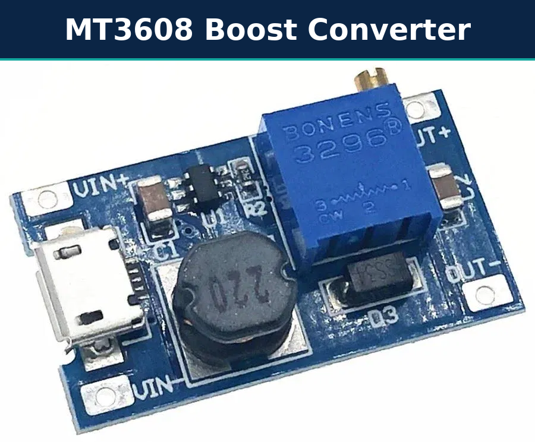 | 3-4.2 V to 5 V | In 2-24 V, out 5-28 V, 2 A max | VIN+, VIN-, OUT+, OUT- | [Robu](https://robu.in/?p=29763) |
| TP4056 Type-C charger with protection | 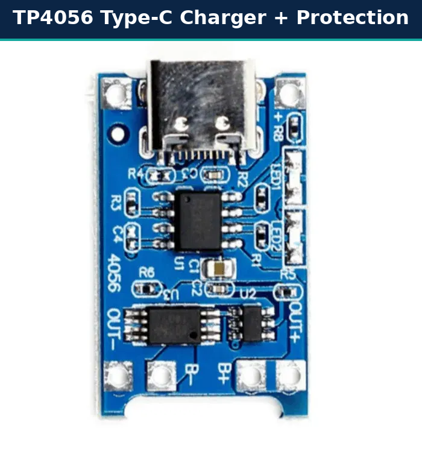 | Charge and protect the cell | 1 A, 4.2 V, DW01A + 8205A | OUT-, B-, B+, OUT+, LED1/LED2 pads | [ShillehTek manual](https://shillehtek.com/blogs/shillehtek-product-manuals/tp4056-1a-lipo-battery-charging-board-type-c-with-current-protection-manual) |
| PAM8403 amplifier (two views, HW-104 on the right) | 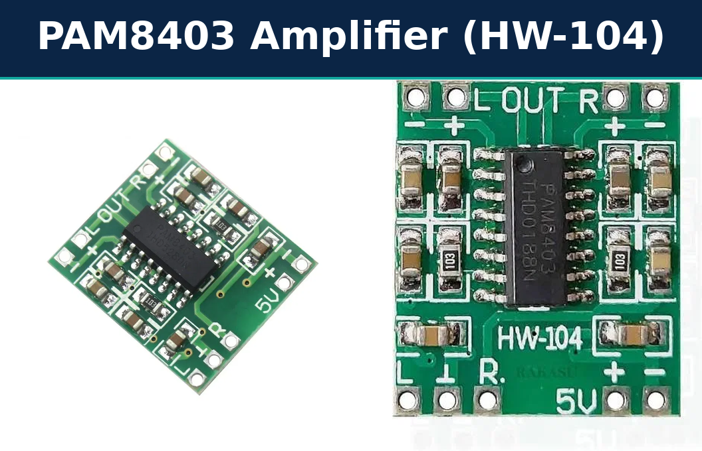 | Drive two speakers | 2.5-5.5 V, 3 W/ch at 4 ohm, BTL, no volume pot | Inputs L, GND, R; power +5V, GND; outputs L-, L+, R+, R- | [Envistia guide](https://envistiamall.com/blogs/learn/pam8403-stereo-audio-amplifier-with-volume-control-switch-user-guide) |
| DFPlayer Mini MP3-TF-16P V3.0 (two views) | 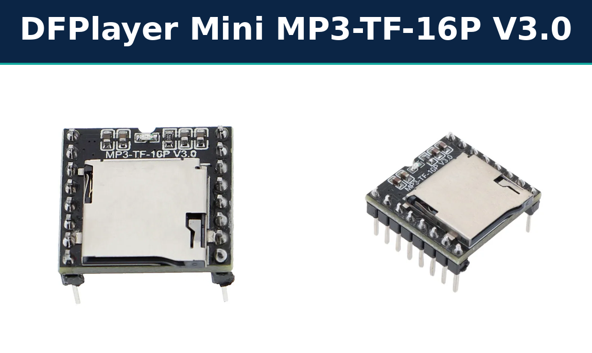 | Play mp3 files from microSD | 3.2-5 V, 3.3 V UART | VCC, RX, TX, DAC_R, DAC_L, GND (pins 1-8); GND (pin 10) | [Manual](https://robu.in/wp-content/uploads/2017/06/DFR0299-DFPlayer-Mini-Manual.pdf) |
| ESP32 NodeMCU 30-pin (CP2102) | 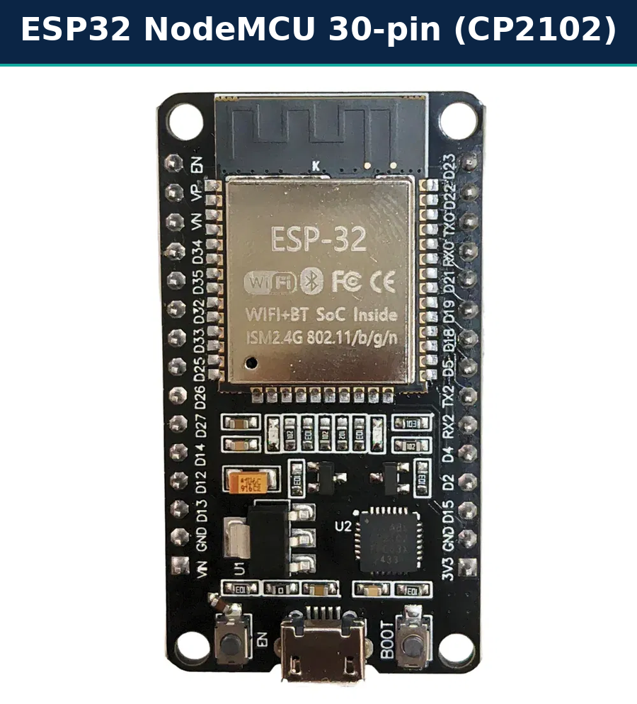 | Controller | 3.3 V logic, 5 V on VIN | VIN, 3V3, GND x2, D21, D22, TX2, RX2, D25, D26, D27 | [Pinout guide](https://esp32.co.uk/esp32-nodemcu-30-pin-pinout-safe-gpios/) |
| PN532 NFC/RFID V3 | 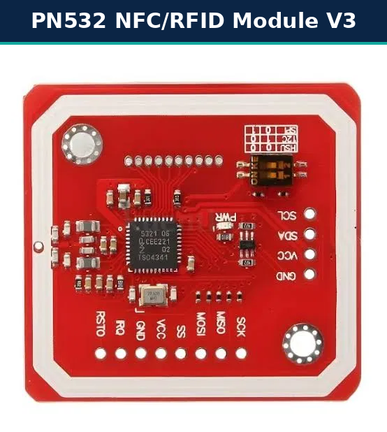 | Read NFC tags | 13.56 MHz, I2C address 0x24 | I2C header SCL, SDA, VCC, GND; mode DIP switch | [ShillehTek manual](https://shillehtek.com/blogs/shillehtek-product-manuals/pn532-nfc-rfid-reader-writer-module-v3-manual) |
| Li-ion cell (BOM says 18650; photo is marked INR21700-45E) | 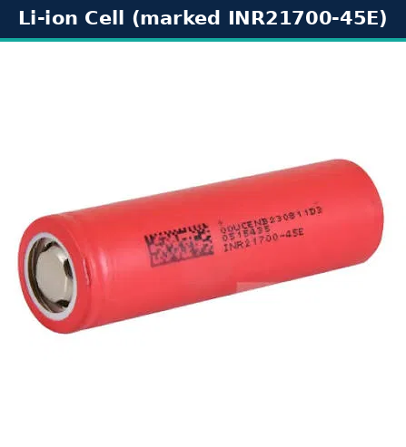 | Power source | 3.7 V nominal; 4500 mAh class if it is a genuine 21700 cell | +, - | see [power-management.md](power-management.md) |
| Main ON/OFF slide switch (SPDT) | 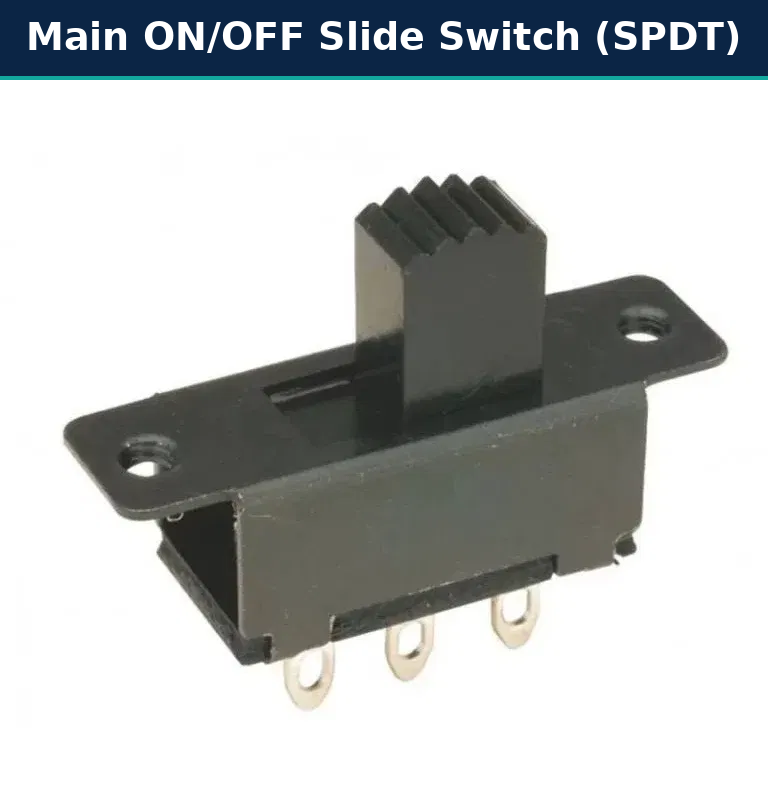 | Interrupt the positive line | Rated above 2 A | COM, OUT, NC | none verified |
| 3 push buttons (6 mm tactile) | 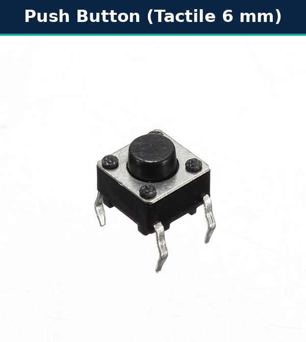 | Volume down (D25), volume up (D26), language (D27) | Momentary, normally open | One side to GPIO, other to GND* | none verified |
| 3 LEDs: red, green, blue | 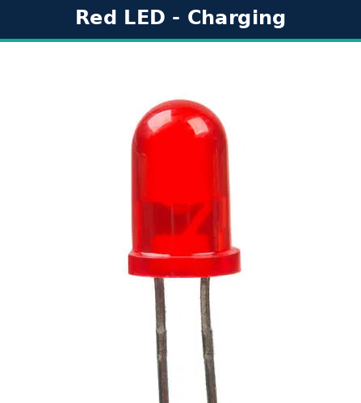 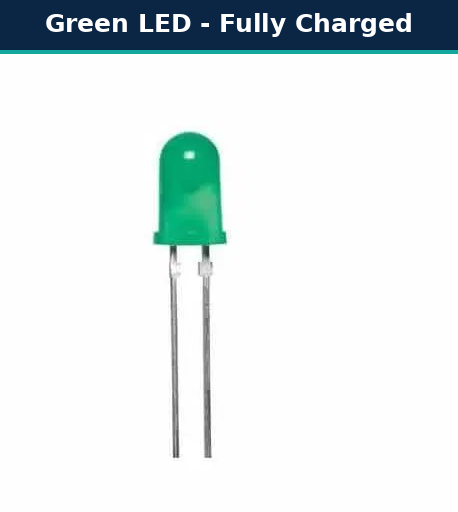 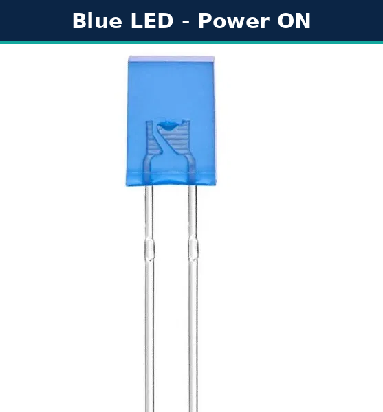 | Charging, fully charged, power ON | About 3 mA each with 1 kOhm | Anode (longer leg) toward the resistor | none verified |
| Resistors (1 kOhm x3 and 1 kOhm UART resistor) | 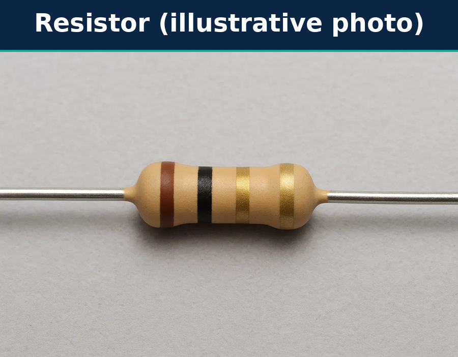 | LED current limit; UART series resistor | 1 kOhm = brown, black, red, gold | - | **Photo caution:** this picture's bands read brown-black-gold-gold (1 ohm), not 1 kOhm; use as a generic illustration only |
| 2 mini speakers (L and R) | 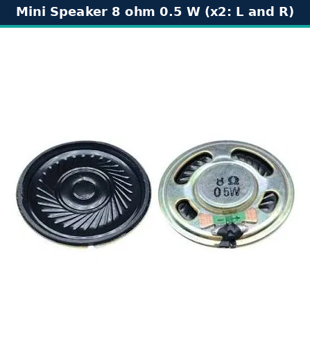 | Sound | **8 ohm, 0.5 W each**: cap the volume | + / - | none verified |
| Prototype PCB (perfboard) | 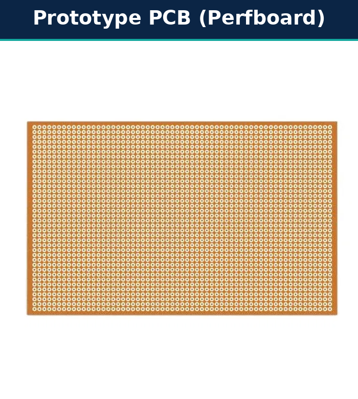 | Mounting and wiring the modules | Single-sided, 2.54 mm pitch | - | none verified |
| NFC tag (NTAG213 or larger) | photo pending | Stores medicine ID | 144 bytes user memory | - | [NXP datasheet](https://nxp.com/docs/en/data-sheet/NTAG213_215_216.pdf) |
| microSD card | photo pending | Stores audio | FAT32, 32 GB or less | - | DFPlayer manual |
| Passives (470 uF, 100 nF), wires, enclosure | photo pending | Reliability | see hardware doc | - | - |

**About these photographs:** they were supplied by the project author. Their original sources and licences were **not recorded**, so they are listed as "unverified" in [`references.md`](references.md); confirm the rights (or replace them with your own photos) before publishing the repository publicly. Observations taken from the photos: the ESP32 board is labelled D21, D22, TX2, RX2, D25, D26, D27, VIN, 3V3 and two GND pins; the PAM8403 is the HW-104 variant (no volume pot); the PN532 offers a four-pin I2C header (SCL, SDA, VCC, GND) and a mode DIP switch; the TP4056 board shows LED1/LED2 footprints on its right edge; the cell is marked INR21700-45E; the speakers are marked 8 ohm 0.5 W; the resistor photo's colour bands do not match 1 kOhm.

## Additional accessories (not assumed to be available)

| Accessory | Notes |
|---|---|
| NFC tag/sticker | **NTAG213 or larger** (NFC Forum Type 2). NTAG213 has 144 bytes user memory (pages 4-39) per the NXP datasheet; our record needs about 16 bytes. Do not use 4-byte-UID MIFARE Classic stickers: unsupported |
| microSD card | 32 GB or smaller, formatted FAT32 (DFPlayer limit) |
| Speakers (two) | Supplied: 8 ohm, **0.5 W** each. Keep the amplifier output at about 2 V RMS or less |
| Prototype PCB (perfboard), wires, headers, connectors | Solder or screw terminals preferred over breadboard for final unit |
| Passive parts | 1 kOhm resistor (ESP32 TX2 to DFPlayer RX), 470 uF 10 V+ electrolytic, 100 nF ceramic |
| Battery holder / enclosure | Non-conductive enclosure; mounting for tag-reading area (keep the PN532 antenna away from metal) |
| LEDs and buttons | Red, green and blue LEDs; three 6 mm tactile buttons |
| Optional | USB-C cable and 5 V charger |
