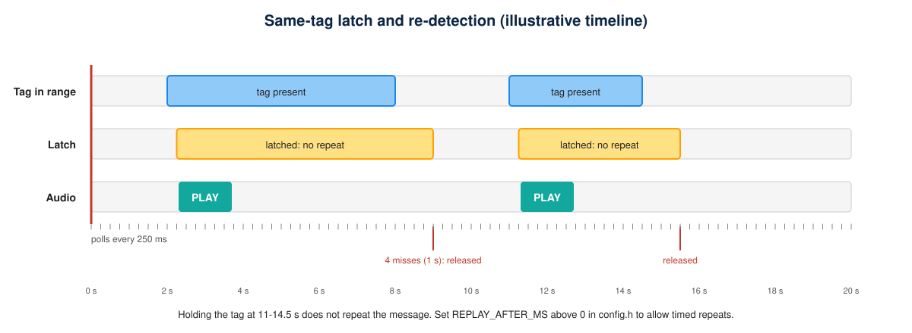

# How It Works

This page follows one tap of a tagged medicine box through the device, using the actual firmware logic. Timing values that are not part of the firmware configuration are **estimates, not measurements**.

## 1. The sequence

| Step | Who | What happens | Where it is in the code |
|---|---|---|---|
| 1 | Tag and PN532 | The PN532 powers the passive tag through its 13.56 MHz field | hardware |
| 2 | ESP32 | Every 250 ms (`TAG_POLL_INTERVAL_MS`) it asks the PN532 for a tag, waiting at most 150 ms (`TAG_POLL_TIMEOUT_MS`) | `loop()` |
| 3 | PN532 | Replies with the 7-byte UID; the IRQ line (GPIO4) goes low when a reply is ready | `readPassiveTargetID()` |
| 4 | ESP32 | A new tag (UID differs from the latched one) is processed once | `processNewTag()` |
| 5 | ESP32 | Reads NTAG pages 4-19 (64 bytes) one page at a time | `readUserMemory()` |
| 6 | ESP32 | Parses the NDEF Text record and checks `TML:nnn` and the language code | `parseTmlNdef()` |
| 7 | ESP32 | Chooses the folder: the language button decides (or the tag, if `LANGUAGE_FROM_TAG` is 1) | `folderForLang()` |
| 8 | ESP32 and DFPlayer | Sends the 10-byte play-folder command at 9600 baud | `playMedicine()` |
| 9 | DFPlayer, PAM8403 | Decodes the mp3 and outputs DAC_L / DAC_R; the amplifier drives both speakers | hardware |
| 10 | ESP32 | Keeps the tag latched until 4 consecutive polls (about 1 s) find no tag | `loop()` |

## 2. What the tag stores

The record is a standard NFC Forum Text record, so any phone NFC app can read it. Language is stored in the standard language field, not in the text. `ndef_parser.h` rejects anything else (blank tag, URL record, UTF-16 text, missing prefix, ID outside 1-255).

## 3. What goes to the audio player

The checksum is the 16-bit two's complement of the sum of bytes 2-7. Both examples were computed with a script when this page was written: play folder 02 file 007 with acknowledgement is `7E FF 06 0F 01 02 07 FE E2 EF`; set volume 9 is `7E FF 06 06 01 00 09 FE EB EF`. At 9600 baud each frame takes about 10.4 ms.

## 4. Why the same tag does not repeat

The firmware remembers the UID of the last tag. While that UID keeps answering polls it is ignored. After `TAG_LOST_MISSES` consecutive misses (4 x 250 ms = about 1 s) the latch is released and the next presentation plays again. `REPLAY_AFTER_MS` above 0 allows a timed repeat while the tag stays in place.

## 5. What the buttons do

Buttons are polled with a 40 ms debounce on every pass through `loop()`, so they work even while a medicine message is playing. A language change plays a spoken confirmation from `/99` and takes effect for the next tag.

## 6. Signal and power chains

- **Signals:** tag -> PN532 -> (I2C + IRQ) -> ESP32 -> (UART) -> DFPlayer -> (DAC_L, DAC_R) -> PAM8403 -> two speakers.
- **Power:** USB-C -> TP4056 -> cell; cell -> switch -> MT3608 (5.0 V) -> ESP32 VIN, DFPlayer, PAM8403; ESP32 3V3 -> PN532. See [power-management.md](power-management.md).
