# Pin Reference

Sources: supplied component photographs (pin labels read from the pictures), the manuals listed in [references.md](references.md), and the author's reference diagram. Always confirm labels on your own boards.

## ESP32 NodeMCU 30-pin (labels read from the supplied photo)

| Side | Pins, top to bottom (board orientation as in the photo) |
|---|---|
| Left | EN, VP, VN, D34, D35, D32, D33, D25, D26, D27, D14, D12, D13, GND, VIN |
| Right | D23, D22, TX0, RX0, D21, D19, D18, D5, TX2, RX2, D4, D2, D15, GND, 3V3 |

### GPIO in use

| GPIO | Label | Direction | Connected to | Notes |
|---|---|---|---|---|
| 21 | D21 | I2C SDA | PN532 SDA | 3.3 V |
| 22 | D22 | I2C SCL | PN532 SCL | 3.3 V |
| 4 | D4 | input | PN532 IRQ | active low data-ready |
| 5 | D5 | input (monitor) | PN532 RSTO | strapping pin: must be high at boot |
| 16 | RX2 | UART2 RX | DFPlayer TX | 9600 baud |
| 17 | TX2 | UART2 TX | 1 kOhm to DFPlayer RX | 9600 baud |
| 25 | D25 | input pull-up | Volume down button | other side to GND* |
| 26 | D26 | input pull-up | Volume up button | other side to GND* |
| 27 | D27 | input pull-up | Language button | other side to GND* |
| 2 | D2 | output | on-board LED (if fitted) | strapping pin, used only as output |
| VIN | VIN | power in | MT3608 OUT+ (5 V) | board regulator makes 3.3 V |
| 3V3 | 3V3 | power out | PN532 VCC | about 50 mA |
| GND (beside 3V3) | GND* | ground | PN532, DFPlayer pin 7, three buttons | |
| GND (beside VIN) | GND | ground | main ground rail | |

Unused but exposed: D12 (strapping), D13, D14, D15 (strapping), D18, D19, D23, D32, D33, D34 and D35 (input only), VP, VN (input only), TX0/RX0 (USB serial: keep free for flashing and the Serial Monitor).

## PN532 NFC/RFID V3 (labels read from the supplied photo)

| Header | Pins | Used |
|---|---|---|
| Right edge (I2C) | SCL, SDA, VCC, GND | all four |
| Bottom edge | RSTO, IRQ, GND, VCC, SS, MOSI, MISO, SCK | RSTO and IRQ only |
| Mode DIP switch | two switches with a printed mode table | S1 ON, S2 OFF for I2C (confirm with an I2C scan: address 0x24) |

## DFPlayer Mini MP3-TF-16P (16 pins, two rows of 8)

| Pin | Name | Used |
|---|---|---|
| 1 | VCC (3.2-5.0 V) | MT3608 5 V |
| 2 | RX | ESP32 TX2 through 1 kOhm |
| 3 | TX | ESP32 RX2 |
| 4 | DAC_R | PAM8403 R input |
| 5 | DAC_L | PAM8403 L input |
| 6 | SPK1 | not used (amplified output) |
| 7 | GND | ESP32 GND* |
| 8 | SPK2 | not used (amplified output) |
| 9 | IO1 | not used |
| 10 | GND | PAM8403 GND (between L and R) |
| 11 | IO2 | not used |
| 12, 13 | ADKEY1, ADKEY2 | not used |
| 14, 15 | USB+, USB- | not used |
| 16 | BUSY | not used (firmware uses events instead) |

## PAM8403 module (HW-104 variant)

| Group | Pads | Connected to |
|---|---|---|
| Inputs | L, GND, R | DFPlayer DAC_L, DFPlayer pin 10, DFPlayer DAC_R |
| Power | 5V (+), GND (-) | 5 V rail, main ground rail |
| Output left | L-, L+ | Speaker L |
| Output right | R+, R- | Speaker R |

Outputs are bridge-tied: never connect an output pad to ground or to another output.

## TP4056 Type-C module

| Pad | Meaning | Connected to |
|---|---|---|
| USB-C connector | 5 V charging input | charger |
| B+, B- | battery terminals | cell + and - |
| OUT+, OUT- | protected load output | switch COM, MT3608 VIN- |
| VCC pad (top right, marked +) | USB 5 V | red and green LED resistors |
| Chip pin 7 (CHRG), pin 6 (STDBY) | open-drain status outputs | LED cathodes |
| LED1, LED2 footprints | on-board indicator LEDs | optional alternative attachment points |

## MT3608 boost module

| Pad | Meaning | Connected to |
|---|---|---|
| VIN+, VIN- | input 2-24 V | switch OUT terminal, TP4056 OUT- |
| OUT+, OUT- | output, trimmer adjusted | 5 V rail, ground rail |
| Trimmer (3296) | output voltage adjust | set to 5.0 V with a meter |
| Micro-USB | alternative input | not used |

## Slide switch (SPDT, three lugs)

COM <- TP4056 OUT+, OUT lug -> MT3608 VIN+, NC unused. Confirm with a meter which lug conducts to COM in the ON position.
