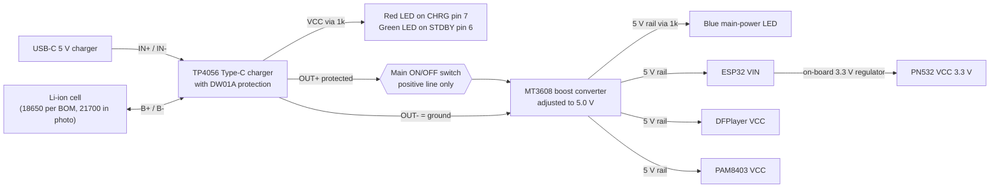

# Power Management and Charging

## Why the MT3608 does not charge the battery

The MT3608 is a one-way **boost** converter: it raises the cell voltage (about 3.0-4.2 V) to 5 V for the electronics. It has no battery-charging function. Charging is done only by the **TP4056** (constant-current / constant-voltage to 4.2 V), fed from the USB-C input.

## Wiring

- Cell + to TP4056 **B+**, cell - to **B-**.
- TP4056 **OUT+** -> switch **COM**; switch **OUT** terminal -> MT3608 **VIN+** (NC unused); TP4056 **OUT-** -> MT3608 **VIN-**.
- Never put the load on B+/B-: that bypasses the protection chip.
- Charge with the main switch **OFF**. Suppliers note the load should be disconnected while charging, because the board is not a power-path manager (a load changes what the charger sees and can stop it terminating correctly).

## Boost converter adjustment (before first power-up of any module)

1. Connect **only** TP4056 OUT -> switch -> MT3608 input. Leave the output unconnected.
2. Switch ON. Measure OUT+ to OUT- with a multimeter.
3. Turn the trim potentiometer (counter-clockwise raises voltage per supplier notes; it may need many turns) until the meter reads **5.0 V (4.95-5.10 V)**.
4. Switch OFF, wait 10 s, connect the 5 V rail, switch ON, re-measure on the rail. Record the values in `tests/hardware-validation-checklist.md`.
5. Never assume the factory setting is 5 V: it can be well above (up to 28 V possible) and would destroy the modules.

## Voltage measurements before first power-up

| Point | Expected |
|---|---|
| Cell terminals | 3.0-4.2 V, correct polarity |
| TP4056 OUT+ to OUT- | Same as cell (about 3.0-4.2 V) |
| MT3608 VIN+ with switch ON | Same as cell |
| MT3608 VOUT | 5.0 V |
| ESP32 3V3 pin | 3.3 V |
| PN532 VCC | 3.3 V |
| DFPlayer VCC, PAM8403 VCC | 5.0 V |

## Current budget (ESTIMATES - not measured)

The supplied speakers are marked **8 ohm, 0.5 W** (photo in `images/components/speaker-8ohm-0.5w.png`). Their rating, not the amplifier, sets the useful maximum output: 0.5 W into 8 ohm is about **2.0 V RMS** across the speaker (0.25 A RMS). The PAM8403 can deliver several times that at 5 V, so the volume must be limited in firmware and checked with a meter (see below).

| Load (at 5 V rail) | Typical | Peak | Basis |
|---|---|---|---|
| ESP32, radios off | 50-80 mA | 120 mA | Engineering estimate; Wi-Fi is never started |
| PN532 polling | 20-50 mA | 50 mA | ShillehTek manual: about 20 mA idle, 50 mA active RF |
| DFPlayer Mini | 20-30 mA | 40 mA | Manual: 20 mA standby; playback figure is an estimate |
| PAM8403 + two 0.5 W speakers | 6 mA idle | about 0.25 A with both speakers at their 0.5 W rating (1 W out / 0.8 efficiency / 5 V) | Power calculation |
| LEDs | about 3 mA (blue); red/green only on USB | 10 mA | (5 V - about 2 V) / 1 kOhm |
| **Total** | **about 0.2-0.3 A** | **about 0.5 A** | |

Battery-side current for a boost converter (efficiency assumed 85%): `I_bat = (5 V x I_rail) / (0.85 x V_bat)`.

| Case | Rail | Battery 3.7 V | Battery 3.2 V (nearly empty) |
|---|---|---|---|
| Typical speech at the volume cap | 0.3 A | 0.48 A | 0.55 A |
| Speakers at rated 0.5 W each | 0.5 A | 0.8 A | 0.92 A |
| **Overdriven** (amplifier near its 8 ohm maximum, speakers far above rating) | about 1.2 A | 1.9 A | 2.2 A |

At the rated speaker power the converter and the TP4056 protection have plenty of margin. The overdriven case would exceed the converter's comfortable range and would also **damage 0.5 W speakers**, so the firmware caps the volume (`VOLUME_MIN` 3, `VOLUME_MAX` 15, start 9; DFPlayer volume scale 0-30). These numbers are conservative starting values: calibrate them (below). Also add the 470 uF capacitor on the 5 V rail and check for ESP32 resets at the highest allowed volume.

### Calibrating the volume cap
1. Play a speech recording at the maximum allowed volume with the speakers connected.
2. Measure AC volts across one speaker with a multimeter in AC mode (speech is not a steady tone, so use a 1 kHz test mp3 for this check).
3. Keep the reading at or below about 2 V RMS (0.5 W into 8 ohm). Lower `VOLUME_MAX` until it is.
4. Listen for distortion or buzzing; both mean the amplifier is clipping or the speaker is overdriven.

## Runtime estimate

Idle draw is about 0.14 A at 5 V (plus about 3 mA for the blue LED), which is about 0.22 A from the cell. For a **genuine 4500 mAh** cell that is roughly 20 h of standby; with a cell of unknown real capacity (for example 2000 mAh) it is roughly 8 h. Playback adds a little. These are estimates only.

## Battery checks

- **Cell type:** the supplied photo (`images/components/li-ion-cell-inr21700.png`) shows a cell marked **INR21700-45E**. That is a **21700** cell (about 21 mm x 70 mm), not an **18650** (18 mm x 65 mm) as the bill of materials says. A 4500 mAh rating is realistic for a genuine 21700 of that class, so the earlier warning that "4500 mAh on an 18650 is overstated" does not apply to this cell. Measure the diameter and length, confirm which cell you have, and make sure the battery holder fits it.
- Even so, treat the capacity as unverified until measured (discharge test with a known load, or a hobby charger/analyser), and compare the marking and weight with the manufacturer's datasheet for that exact model.
- Check whether a protection PCB is fitted (a bare cell is normal here; the TP4056 board's DW01A provides the protection).
- Discharge capability: confirm the cell is rated for the load (the loads above are well under 1 A at the volume cap).
- The TP4056 default charge current is 1 A (R3 = 1.2 kOhm): suitable for a 4500 mAh cell (about 0.22 C). For a smaller or doubtful cell, increase R3 for 0.5 A.

## Safe handling

Use a battery holder or tabbed cell, insulate every joint, never short the cell, never charge unattended on a flammable surface, stop using a cell that swells, gets hot, or smells. Do not puncture or crush. Dispose at a battery recycling point.
