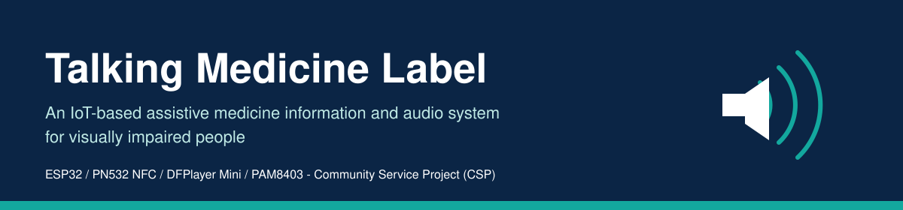
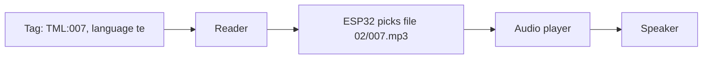

# Project Overview

The Talking Medicine Label is a small battery-powered device. A tag stuck on a medicine container stores a short code and a language. When the container is held near the reader, the device speaks a prerecorded instruction from its memory card.

The device is an **aid**. Recordings must be prepared and checked by a qualified person (pharmacist or doctor). It never replaces prescriptions, pharmacist advice, or the doctor's instructions.

See the root [README](../README.md) for the full report.
