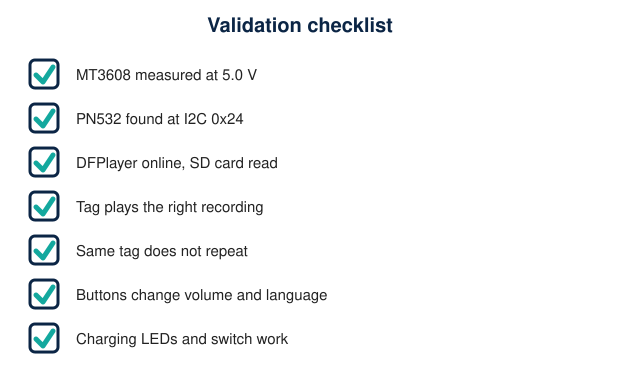

# Testing and Troubleshooting

| Symptom | Likely cause | Diagnostic steps |
|---|---|---|
| PN532 not detected ("PN532 NOT found") | DIP switches not in I2C; SDA/SCL swapped; no 3.3 V | Power off, set S1 ON / S2 OFF; measure PN532 VCC (3.3 V); swap SDA/SCL; run an I2C scanner: expect 0x24; shorten wires |
| NFC tag not recognised | Wrong tag type, metal behind tag, too far | Distance 1-4 cm; stickers need non-metal surface or on-metal tag; the serial monitor prints the UID: 7 bytes expected (NTAG) |
| Incorrect NFC mode settings | S1/S2 wrong, or I2C bus read as UART | Re-set before power-up; check the silkscreen ON direction with tweezers |
| Tag read but "invalid" | Tag not written as NDEF Text `TML:nnn`, or language missing | Read it back with a phone NFC app; confirm text and language code; blank tags give status 1 |
| DFPlayer not initialised | TX/RX swapped; no SD; SD not FAT32; baud mismatch; supply sag | Cross TX/RX; reformat FAT32 (32 GB or less); verify 5 V at VCC while powering; wait 2 s boot |
| SD card or audio file not found | Wrong folder or name | Expect `/01/007.mp3` style (2-digit folder, 3-digit file); remove macOS `._` files (`dot_clean`); serial prints the missing path |
| No speaker output | PAM8403 knob off; speaker wired to ground; audio not on DAC_L | Click knob ON if present; check L+/L- continuity to speaker; measure 5 V at PAM VCC; try a headphone on DAC_L (with series resistor) |
| Buzzing or distorted sound at higher volume | 0.5 W speakers overdriven or amplifier clipping | Lower `VOLUME_MAX`; measure AC voltage across the speaker (about 2 V RMS maximum) |
| Excessive noise or distortion | Ground loop; long audio wires; high volume; no decoupling | Add C1/C2; twist DAC_L with GND; lower `DFPLAYER_VOLUME`; separate speaker wires from I2C |
| ESP32 resets during playback | Brown-out: converter overloaded; weak cell; poor wiring | Scope or meter the 5 V rail under load; lower the volume cap; 470 uF cap; thicker wires; test with a bench 5 V supply |
| Converter output incorrect | Trim not set; bad input; overload | Remove load, re-adjust to 5.0 V; check VIN; remember output cannot be below input |
| Buttons do nothing / act twice | Wiring to GPIO25/26/27 not returned to GND; bouncing or damaged button | Check continuity of each button; Serial Monitor prints "Volume n" or "Language selected" on each press; try another GPIO only if you change `config.h` |
| LEDs not lit | Wrong polarity, missing resistor, no USB power (red/green) | Anode on the resistor side; red/green glow only with USB power on TP4056 VCC; blue needs the switch ON |
| Only one speaker plays / hum | R channel wiring, or ground loop through GND_in | Check DAC_R to R in and R+/R- to speaker R; test with GND_in disconnected from DFPlayer pin 10 to compare hum |
| No power when switch is ON | Wired to NC instead of the throw that joins COM; wrong terminal | With a meter, find which terminal conducts to COM in the ON position and wire that one to MT3608 VIN+ |
| Battery charging problems | Load connected while charging; poor cable; faulty cell; wrong terminals | Switch OFF; measure IN+ (4.5-5.5 V); LED states red/green; cell voltage rising; stop if warm/hot |

## Multimeter quick checks

| Check | Expected |
|---|---|
| Continuity PAM8403 L- and R- to GND | Open (no continuity) |
| Continuity L- to R- | Open |
| Continuity DFPlayer pin 7 to pin 10 | Closed (same GND net) |
| OUT+ to OUT- before connecting loads | 5.0 V |
| ESP32 3V3 | 3.3 V |
| DFPlayer VCC | about 5 V steady during playback (drop below 4.5 V = supply problem) |

## Test status

No hardware test has been run by the repository author. A host-side unit test of the tag parser exists (`tests/ndef_parser_test.cpp`: 11 cases, all pass on a PC). The firmware has **not** been compiled in Arduino IDE.
