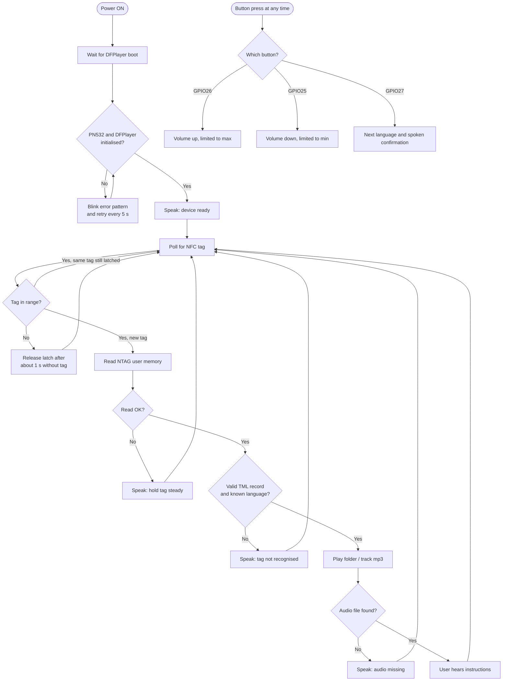

# Firmware: talking-medicine-label

*The labels D21, D22, TX2, RX2, D25, D26, D27, VIN, 3V3 and GND on the board are the pins this firmware uses (photo supplied by the author; licence unverified).*

*Pins used by this firmware (GPIO21, 22, 16, 17, 25, 26, 27) appear in the diagram above.*

## Status
Written, **not compiled in Arduino IDE and not run on hardware** by the author. Only `ndef_parser.h` has been tested (on a PC, 11 cases, all pass). Record the library versions you test with in `tests/hardware-validation-checklist.md`.

## Setup
1. Arduino IDE 2.x. Boards Manager: install **esp32 by Espressif Systems**. Board: *ESP32 Dev Module*; port of the CP2102 (install the Silicon Labs CP210x driver if needed).
2. Library Manager: **Adafruit PN532** (also install **Adafruit BusIO** if prompted) and **DFRobotDFPlayerMini** (DFRobot).
3. Open `talking-medicine-label.ino`. Pins and behaviour are in `config.example.h`; optionally copy it to `config.h`.
4. Upload with the main switch OFF (power from USB), then disconnect USB and run from battery.
5. Serial Monitor 115200 baud shows initialisation, UID, parsed language/ID and file played.

## Tag format and SD layout
NDEF Text record, text `TML:<1-255>`, language `en`/`te`/`hi` -> plays `/<folder>/<id>.mp3` (en=01, te=02, hi=03). Details: `nfc-data/README.md`, `audio/README.md`.

## Buttons
Wired as in the reference diagram, top to bottom: D25 volume down, D26 volume up, D27 language; common return to the ESP32 GND beside 3V3.

GPIO26 volume up, GPIO25 volume down (step 2, range 3-15, start 9; calibrate for the 0.5 W speakers), GPIO27 next language (English, Telugu; Hindi when `LANG_COUNT` is 3), with a spoken confirmation of the language. Changing the language does not replay the current medicine; remove and re-present the tag.

## Behaviour
Same-tag latch (no repeat while in range); released after about 1 s without the tag; `REPLAY_AFTER_MS` optional timed replay; retries for PN532 and DFPlayer initialisation; error prompts for unreadable, invalid and missing-audio cases.
