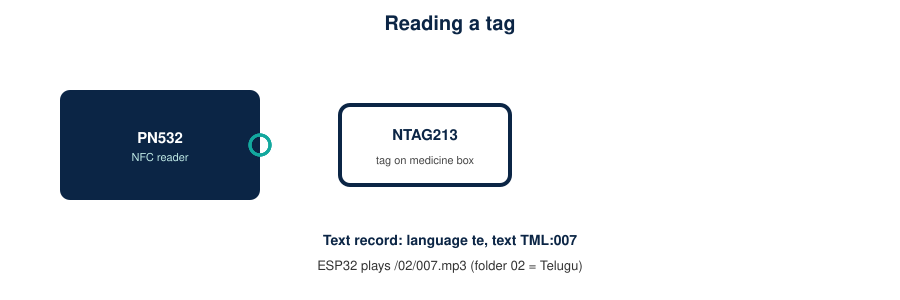
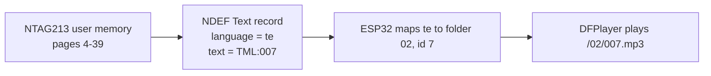

# NFC tag data

*PN532 module: I2C header SCL, SDA, VCC, GND on the right edge and the mode DIP switch at the top (photo supplied by the author; licence unverified).*

**On the tag:** one short NDEF Text record: language code (`en`, `te`, `hi`) and text `TML:` + ID 1-255 (about 16 bytes; NTAG213 has 144 bytes user memory per NXP). **On the microSD:** the spoken content. The tag holds no long text and nothing is translated or synthesised.

**Programming a tag:** with a phone NFC-writer app, write a *Text* record with the required language and text, then verify by tapping the tag on the device and reading the Serial Monitor (it prints language and ID). If your app cannot set the language code, use one that can, or the tag will be rejected or mapped wrongly. Optionally lock the tag after writing.

**Which language plays?** By default (`LANGUAGE_FROM_TAG 0`) the **language button** (GPIO27) chooses the playback language and the tag only has to carry a valid known language code. Set `LANGUAGE_FROM_TAG 1` in the config to play the language stored on the tag instead.

**Validation rules:** NTAG with 7-byte UID; single short Text record; UTF-8; text starts `TML:`; ID 1-255; language known. Anything else plays the "not recognised" prompt. Examples: `examples/`.
