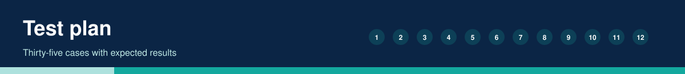
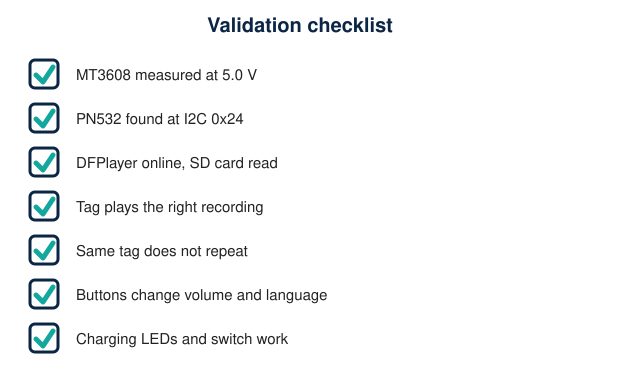

# Test Plan

35 cases across power, NFC, audio, buttons and robustness. **Every result is 'not run'**: no hardware test has been performed. Record outcomes here and in [hardware-validation-checklist.md](hardware-validation-checklist.md).

| ID | Area | Test | Steps | Expected | Result |
|---|---|---|---|---|---|
| P1 | Power | Cell voltage before assembly | Meter across the cell | 3.0-4.2 V | not run |
| P2 | Power | TP4056 protection chips present | Visual check | chips marked DW01A and 8205A | not run |
| P3 | Power | MT3608 adjustment | Output unconnected, meter on OUT+/OUT-, turn trimmer | 5.0 V (4.95-5.10) | not run |
| P4 | Power | Switch wiring | Meter: COM to OUT in ON and OFF | closed in ON, open in OFF | not run |
| P5 | Power | 5 V rail loaded | All modules connected, meter on rail | 4.9-5.1 V | not run |
| P6 | Power | ESP32 3V3 | Meter on 3V3 pin | 3.3 V | not run |
| P7 | Power | Blue LED | Switch ON | lit | not run |
| P8 | Power | Charging LEDs | Switch OFF, connect USB-C | red while charging, green when full | not run |
| P9 | Power | Charge current and heat | Watch the TP4056 and cell for 10 min | no hot parts | not run |
| N1 | NFC | I2C scan | Run an I2C scanner | address 0x24 | not run |
| N2 | NFC | PN532 init | Reset the ESP32 | 'PN532 online.' in Serial Monitor | not run |
| N3 | NFC | IRQ idle level | Meter on GPIO4 line | high (3.3 V) | not run |
| N4 | NFC | RSTO idle level | Meter on GPIO5 line | high (3.3 V) | not run |
| N5 | NFC | Valid English tag | Present TML:001 / en | UID and 'Valid tag' printed | not run |
| N6 | NFC | Valid Telugu tag | Present TML:001 / te | parsed language te | not run |
| N7 | NFC | Blank tag | Present a blank NTAG | not-recognised prompt | not run |
| N8 | NFC | URL tag | Present a tag with a URL record | not-recognised prompt | not run |
| N9 | NFC | ID out of range | TML:000 and TML:256 | not-recognised prompt | not run |
| N10 | NFC | Range | Move the tag away in 1 cm steps | record the maximum distance | not run |
| A1 | Audio | DFPlayer init | Reset the ESP32 | 'DFPlayer online.' | not run |
| A2 | Audio | English playback | Present TML:001 / en with English selected | /01/001.mp3 plays | not run |
| A3 | Audio | Telugu playback | Select Telugu, present a tag | /02/001.mp3 plays | not run |
| A4 | Audio | Missing file | Present TML:200 | 'Audio file missing' prompt | not run |
| A5 | Audio | No SD card | Remove the card, reset | error blinks, no crash | not run |
| A6 | Audio | Both speakers | Play a stereo test file | left and right both sound | not run |
| A7 | Audio | Speaker voltage at max volume | 1 kHz test file, AC volts across each speaker | 2 V RMS or less | not run |
| A8 | Audio | Hum check | Silence with volume at maximum | no audible hum | not run |
| B1 | Buttons | Volume up | Press D26 repeatedly | level rises to 15, limit beep | not run |
| B2 | Buttons | Volume down | Press D25 repeatedly | level falls to 3, limit beep | not run |
| B3 | Buttons | Language | Press D27 | spoken language name; alternates | not run |
| B4 | Buttons | Button during playback | Press while a message plays | responds, no crash | not run |
| R1 | Robustness | Same tag held | Hold a tag for 30 s | one playback only | not run |
| R2 | Robustness | Re-present | Remove 2 s, present again | plays again | not run |
| R3 | Robustness | Loud playback | Maximum volume for a long message | no ESP32 reset | not run |
| R4 | Robustness | Battery low | Run until near cut-off | no corruption, clean shutdown by protection | not run |

## Host-side test already run

`tests/ndef_parser_test.cpp` (11 cases, all pass on a PC): English and Telugu records, case folding, ID 0 and 256, non-numeric ID, wrong prefix, UTF-16 text, blank tag, URL record, truncated data.
